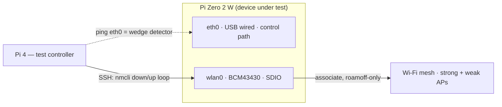

# Full troubleshooting write-up — Pi Zero 2 W Wi-Fi `status_code=16` on a mesh

[← Back to README](../README.md) · Languages: **English** · [繁體中文](troubleshooting.zh-TW.md) · [日本語](troubleshooting.ja.md) · [한국어](troubleshooting.ko.md)

> Real field notes from a home deployment of three Raspberry Pi boards (a Zero 2 W, a 3B+, and a Pi 4) on a Xiaomi Wi-Fi 7 mesh (BE6500 + BE3600). Host-specific secrets (Wi-Fi password, SSID, BSSID, internal IPs) are replaced with placeholders.

## 1. One-sentence conclusion

The Zero 2 W's Wi-Fi chip is an old **BCM43430** (firmware `7.45.96.s1`, 2023). Two things actually matter — the encryption, and **disabling the firmware's roaming engine**:

1. **Encryption — use pure WPA2-PSK** (see the "Encryption modes" table just below: pure WPA3/SAE always fails; mixed mode connects but is flaky).
2. **Driver-level: `options brcmfmac roamoff=1`** — disables the firmware roaming engine, which is exactly what **mesh band steering** (the real main culprit) trips over. On the test network this alone reliably connects *and* self-selects the strong AP on **~88% of cold boots** (see §7c) — **no hard-pinned BSSID required**, and the config stays portable.
3. **(Optional — only if you need it) pin a strong-node BSSID** (`802-11-wireless.bssid AA:BB:CC:DD:EE:FF`) — this *guarantees* the strong AP every time, but it is brittle: it breaks when you change routers (see the Portability box in §3). Add it only if `roamoff=1` alone still lands you on a bad AP, or your mesh keeps rejecting.

### Encryption modes — the precise facts (important)

| AP encryption | Result on this old chip |
|---|---|
| Pure WPA3 / SAE | **Always fails** (confirmed by a Zenfone control test: a single AP on pure WPA3 failed, on pure WPA2 connected instantly) |
| WPA2/WPA3 **mixed** | **Connects but is flaky** — the client (wpa_supplicant) negotiates PSK instead of SAE, so it *can* associate. On a strong-signal cold boot it connects in ~1–2 s; on a weak signal or a warm reboot it takes several rejects (up to ~4, ~35 s seen) or fails. **⚠️ Only with `wpasupplicant` ≤ `2:2.10-24`: from `2:2.10-24+rpt3` (2026-11) on, mixed mode fails completely — see the [2026-11 update in the README](../README.md#2026-11-update).** |
| Pure WPA2 | **Reliable** (recommended) |

> Note: this deployment now runs **roamoff-only (no BSSID pin), on mixed-mode encryption, at a strong signal** — Wi-Fi is only the backup link and the pin's brittleness wasn't worth it (see §7c for the data behind dropping the pin). Switch to pure WPA2 if you want the mixed-mode flakiness gone. Also note: there is **no driver-level SAE protection** here — `feature_disable` doesn't take effect on this chip (see §3), so mixed mode works purely because the *client* prefers PSK. (2026-11: to keep mixed mode working, this deployment had to downgrade and hold `wpasupplicant` at `2:2.10-24` — see the [README update](../README.md#2026-11-update).)

## 2. Identifying the problem

```
wpa_supplicant: wlan0: CTRL-EVENT-ASSOC-REJECT bssid=00:00:00:00:00:00 status_code=16
wpa_supplicant: wlan0: CTRL-EVENT-SSID-TEMP-DISABLED ... auth_failures=N reason=CONN_FAILED
```

- `nmcli con up` eventually says `Secrets were required, but not provided`. This is a **misleading** NetworkManager message after repeated association failures — **the password is correct**.
- `bssid=00:00:00:00:00:00` (all zeros) = the firmware rejected the association **before** the 4-way handshake → AP encryption/mode incompatibility, not credentials.

Check what the AP is actually advertising:

```bash
sudo iw dev wlan0 scan | grep -iA22 'SSID: <YOUR_SSID_2G>' | grep -iE 'RSN|Authentication suites|Capabilities|MFP'
```

| Scan shows | Meaning | Old chip result |
|---|---|---|
| `Authentication suites: PSK SAE` | WPA2/WPA3 **mixed** (SAE present) | connects but flaky |
| `Authentication suites: SAE` | pure WPA3 | **always fails** |
| `Authentication suites: PSK` | pure WPA2 | **works** |

> **⚠️ Don't trust your router's app label.** A mesh router can show "WPA2" in its app while the beacon still advertises SAE — the "WPA2" option often keeps WPA3 compatibility, or you changed the main router but a mesh node didn't sync. Always verify *from the client* with the scan above: you must see `Authentication suites: PSK` with **no** `SAE`. (Symptom of lingering SAE: the Pi connects intermittently — fine on a strong signal, rejected on a weak one or after a reboot.)

## 3. The fix (pure WPA2 + roamoff=1; BSSID pin optional; Wi-Fi 6/7 can stay on)

**Router:** set the 2.4 GHz SSID to **pure WPA2-Personal** (turn off WPA3/mixed). Wi-Fi 6/7 may stay enabled. The mesh will still band-steer, but `roamoff=1` on the client handles that — a BSSID pin is *optional* (see below).

**Client (default — roamoff-only, no pin):**

```bash
sudo nmcli con modify "<YOUR_SSID_2G>" \
  802-11-wireless-security.key-mgmt wpa-psk \
  802-11-wireless-security.psk '<YOUR_WIFI_PASSWORD>' \
  802-11-wireless-security.pmf disable \
  connection.autoconnect yes connection.autoconnect-retries 0
sudo nmcli con up "<YOUR_SSID_2G>" ifname wlan0
```

Then apply the driver-level `roamoff=1` (see "Driver-level mitigation" below) — that is the step that actually beats band steering. `connection.autoconnect-retries 0` = retry forever (steering may block the first one or two attempts on boot; it retries through).

**Optional — pin the strong AP** (only if roamoff-only keeps landing you on a weak/wrong node):

```bash
sudo nmcli con modify "<YOUR_SSID_2G>" 802-11-wireless.bssid AA:BB:CC:DD:EE:FF
```

### ⚠️ Portability: a pinned BSSID is tied to your AP's hardware

A BSSID is **the MAC address of one specific AP radio**, so pinning it binds the client to that exact hardware. It is a workaround for **band steering only**, and it is brittle by design:

| Situation | Result |
|---|---|
| You **change router / mesh** | The new AP has a new MAC → the pinned BSSID doesn't exist → the Pi **never connects** until you update it |
| The pinned node is **off / moved / fails** | The Pi **won't roam** to another node (pinned + `roamoff=1`) |
| Router **factory reset / radio swap** | MAC may change → pin becomes invalid |

Recovery is one line — re-scan and update, or unpin:

```bash
# find the new strong node
sudo iw dev wlan0 scan | grep -iB5 'SSID: <YOUR_SSID_2G>' | grep -iE 'BSS|signal'
# update to it ...
sudo nmcli con modify "<YOUR_SSID_2G>" 802-11-wireless.bssid <NEW_BSSID>
# ... or remove the pin entirely
sudo nmcli con modify "<YOUR_SSID_2G>" 802-11-wireless.bssid ""
```

**When you don't need the pin at all:**
- **Single AP (non-mesh):** no band steering → pure WPA2 + `roamoff=1` is usually enough. Fully portable, survives router changes.
- **Another mesh:** you'll need to re-pin to the new mesh's strong node.
- **Cleanest (AP-side):** give the old client a dedicated SSID with band steering disabled / bound to one node — then the client never pins anything and nothing breaks when you swap clients or change firmware.

### Driver-level mitigation (recommended)

```
# /etc/modprobe.d/brcmfmac.conf
options brcmfmac roamoff=1
```

`roamoff=1` disables the firmware's internal roaming engine — directly targeting band steering. Apply with `sudo modprobe -r brcmfmac && sudo modprobe brcmfmac`, or reboot. Confirm it took: `cat /sys/module/brcmfmac/parameters/roamoff` → `1`.

> **A measured caveat on `feature_disable`.** Many forum posts recommend
> `options brcmfmac roamoff=1 feature_disable=0x82000` (the `0x82000` is meant to disable SAE + SWSUP). **On this BCM43430 it had no observable effect** — `cat /sys/module/brcmfmac/parameters/feature_disable` came back *empty* (the driver doesn't expose this parameter via sysfs on this chip). Only `roamoff=1` measurably helped. Your mileage on a different chip may differ.

### What NOT to bother with (client-side)

These were all tried and made **no difference** — the problem is on the AP side, not in the Pi's config:

- `nmcli con modify "<YOUR_SSID_2G>" wifi-sec.proto rsn wifi-sec.pairwise ccmp wifi-sec.group ccmp wifi-sec.pmf disable`
- `iw reg set <CC>` / `raspi-config nonint do_wifi_country <CC>` (setting the regulatory country)
- `rfkill unblock` / repeatedly reconnecting

The only two client-side things that matter are encryption (pure WPA2) and `roamoff=1`. Everything else is a distraction — fix it at the AP, don't tweak client knobs.

## 4. Hardware context — stock vs. modified Zero 2 W

A **stock Zero 2 W is Wi-Fi only.** This deployment added a **USB Ethernet HAT** (Waveshare ETH/USB HUB, chip set: Realtek **RTL8152B** USB→10/100, USB hub **FE1.1S**), giving a wired `eth0`. Everything shares **one USB 2.0 bus** (Pi → FE1.1S hub → RTL8152). Implications:

- 100 Mbit max (USB 2.0 ceiling) — `eth0 speed=100` is normal.
- The hub draws 5 V from the Pi. A **brownout or bad contact can drop the entire bus** — the `eth0` netdev *disappears*, so any link-state check must tolerate `ENOENT` and not crash.
- With Ethernet present you can run **wired-primary, Wi-Fi-backup** (the most robust setup). Without it (most readers), the Wi-Fi fix above is your only link and matters even more.

## 5. Firmware version & the "downgrade to 9.88.4.65" trap

On-device check (`dmesg | grep brcmf`):

```
using brcm/brcmfmac43430-sdio for chip BCM43430/1
Firmware: BCM43430/1 wl0: Jun 14 2023 ... version 7.45.96.s1 (gf031a129)
```

- Chip = **BCM43430/1** (rev 1), firmware = **`7.45.96.s1`** (loads `cypress/cyfmac43430-sdio.bin`).

⚠️ **The widely-repeated "downgrade to firmware 9.88.4.65" advice (from upstream issue #27) does NOT apply here.** That report is about a **BCM43430/2 → 43436** chip on the **9.88.4.x** firmware lineage. This board is **BCM43430/1 → 7.45.x** — a completely different firmware family. `9.88.4.65` does not exist for this chip; forcing the wrong chip's `.bin` can break Wi-Fi entirely. Issue #27 is cited here as a *root-cause reference* ("why mesh switching halts the firmware"), **not** a prescription to downgrade.

| | This board | Issue #27's board |
|---|---|---|
| Chip | BCM43430**/1** | BCM43430**/2** (43436) |
| Firmware family | **7.45.x** (`7.45.96.s1`) | **9.88.4.x** (bad `.77` / good `.65`) |
| Firmware file | `cyfmac43430-sdio.bin` | `brcmfmac43436-sdio.bin` |

## 6. Controlled experiments

### 6a. The Wi-Fi generation (6/7) is NOT the culprit (a corrected misdiagnosis)

Early on I suspected the AP's modern Wi-Fi mode. **First, the facts:** this network is actually **Wi-Fi 7** (Xiaomi BE-series; with Wi-Fi 5 compatibility off it runs 802.11be). But the Zero 2 W is an **802.11n (Wi-Fi 4)** chip — it associates at legacy rates and ignores the AP's HE (Wi-Fi 6) / EHT (Wi-Fi 7) features entirely. **Re-enabling the modern mode while keeping pure WPA2, the Zero 2 W still connected — first-try on reconnect, and auto-reconnected on reboot.** So **do not** drop your 2.4 GHz to Wi-Fi 4/5 for one old client (that would slow every 2.4 GHz device). The Wi-Fi generation (6 or 7) isn't the breaker — keep it on, just keep the encryption pure WPA2.

### 6b. Three-device comparison (same bug family, different severity)

| Board | Chip / firmware | Band | `status_code=16` this boot | Outcome |
|---|---|---|---|---|
| **Zero 2 W** | BCM43430 / 7.45.96 (old) | 2.4 GHz only (can't escape steering) | 2–7 rejects per boot, often fails to reconnect | flaky ~60% before fix |
| **Pi 3B+** | BCM4345/6 / 7.45.265 | 5 GHz | 4 (rode through them) | ✅ stays connected |
| **Pi 4** | BCM4345/6 / 7.45.265 | 5 GHz | 0 | ✅ stays connected |

The 3B+ hits the same rejects but rides through them; the newer chip + newer firmware + the ability to sit on 5 GHz (away from the steering battle) makes it a non-issue in practice. **The 3B+/Pi 4 do not need `brcmfmac.conf`** — don't fix what isn't broken.

### 6c. Driver fix — before / after

With WiFi 6 + pure WPA2 + BSSID pin, adding `roamoff=1`:

| | Before | After |
|---|---|---|
| Boot auto-connect | ~60% (40% outright fail) | first boot **0 rejects, instant**; later boots connect within ≤1 reject |
| 15× disconnect/reconnect | — | 6/6 connected, rejects trending 5→4→3→1→0 |

Net improvement. Occasional steering rejects remain (an AP-side behavior the driver can't suppress), but the client now always connects eventually — plenty for a backup link.

### 6d. ⚠️ The wedge: do not stress-test this chip

**Twice in one day the Zero 2 W wedged the entire board** and needed a physical power-cycle (Ethernet + SSH died too):

1. 10× reboot-loop test → froze on iteration 8.
2. Back-to-back disconnect/reconnect test → whole system hung on cycle 6.

Root cause matches upstream **RPi-Distro/firmware-nonfree #27** ("BCM43430/2 firmware stuck when switching between mesh endpoints"): dense mesh re-association can **halt the Wi-Fi firmware**, which on the low-power Zero 2 W cascades into a full-board hang (compounded by USB-hub brownout). After both wedges the SD card was fine (`throttled=0x0`, no ext4 errors) — but repeated hard power-cuts are themselves risky.

**This fragility is specific to the Zero 2 W.** A control test: **Pi 4 and 3B+ each ran 1000× disconnect/reconnect → 1000/1000 success, zero firmware halts, zero board hangs.** The CYW43455 (BCM4345/6, firmware 7.45.265) is immune; it only retries, never halts.

### 6e. Corrected, safe finding: slow reconnects are fine

The wedge is caused by **back-to-back** re-association, not reconnecting per se. With **≥10 s between attempts**: 100 reconnect cycles → **100/100 PASS, zero ASSOC-REJECT, zero hangs, `throttled=0x0` throughout**, each connect in 0–1 s. So as a backup link with normal (non-hammering) behavior, the Wi-Fi is reliable.

> Side note observed during stress: heavy Wi-Fi activity perturbs the USB-attached `eth0` (shared USB bus), so detect a true wedge by "**both** eth0 and wlan0 dead **and** logs frozen," not eth0 alone.

## 7. Follow-up experiments — instrumented reconnect runs & the eth0 "host-stall" finding

A second round of testing was run with better instrumentation. By now the test controller had moved from the Pi 3B+ to a Pi 4 (the 3B+ was being retired), so every run was driven from the Pi 4 over SSH while the Zero 2 W ran a local `nmcli con down/up` loop and wrote its own log.

**Test setup** — the Pi 4 drives the test and watches the wired side; the Zero 2 W is the device under test:



### 7a. Three instrumented 100-round runs

Each run = 100 cycles of `nmcli con down → sleep 5 → con up → wait for IP → sleep N`. Per round we logged PASS/FAIL (did it get an IP?), reconnect time, `ASSOC-REJECT` count, and `vcgencmd get_throttled`. The Pi 4 simultaneously ran a "wedge detector" — pinging the Zero 2 W's **wired** `eth0` to catch a whole-board hang.

| Run | inter-round gap | wedge probe | wlan reconnect | ASSOC-REJECT | throttled≠0 | slow (>3 s) | board wedge |
|-----|------|------|------|------|------|------|------|
| RUN1 | 10 s | single ping (`-c1 -W2`) | **100/100** | 0 | 0 | 0 | none |
| RUN2 | 10 s | 3-ping (`-c3 -W1`) | **100/100** | 0 | 0 | 0 | none |
| RUN3 | 15 s | 3-ping (`-c3 -W1`) | **100/100** | 0 | 0 | 0 | none |

Wi-Fi reconnect was rock-solid across all three (and across both the pinned and the roamoff-only config). The *interesting* result was on the **wired** side.

### 7b. The eth0 "outage" is a host-level stall, not a link drop

The wedge detector kept logging eth0 ping failures — RUN1 (single ping) counted 88; RUN2/RUN3 (3-ping) counted 57/52. They were evenly spaced — **one per reconnect round**, never consecutive. So during each wlan0 reassociation the wired eth0 became unreachable for ~2–3 s, then recovered.

The first instinct (and an earlier note of mine) blamed the shared USB bus: "heavy Wi-Fi activity perturbs the USB-attached Ethernet NIC." **A controlled experiment disproved that.** Triggering one wlan0 reconnect while sampling eth0 at high frequency:

- `eth0 carrier_changes`: **2 → 2 (delta 0)** — the physical link never flapped.
- `carrier` stayed `1` and `operstate` stayed `up` for the entire window.
- The Pi-4 → eth0 ping failures landed *exactly* inside the wlan0 `dormant` reassociation window — while the link stayed up the whole time.

**Conclusion: it is not a physical link drop. The board simply stops *answering* ICMP on eth0 for ~2–3 s during wlan0 reassociation — a host-level stall.** Likely causes: NetworkManager recomputing routes, the weak CPU being busy with `wpa_supplicant`+DHCP, and — notably — **eth0 and wlan0 are on the same subnet**, so reconfiguring one disturbs the shared route. This also rules out the "USB bus" theory *mechanically*: on the Zero 2 W the Wi-Fi is **SDIO** and the Ethernet is **USB** — different buses entirely. A downstream effect of the same stall: an application-layer HTTP connectivity probe (`generate_204`) egressing over eth0 occasionally timed out during a reassociation, because the host briefly couldn't service it.

```text
One wlan0 reconnect: eth0 link never drops, only ICMP stalls (~2-3 s)

  t (s):            0      2      4      6      8     10
  wlan0:            |-- up --|dormant|----- up ----|
  eth0 carrier:     |======== 1, never drops ========|   (carrier_changes 2 -> 2)
  Pi4 -> eth0 ping:  OK     OK    FAIL  FAIL  FAIL   OK
                                  \___ eth0 unreachable ~2-3 s ___/
```

> **Methodology note — instrument the right signal.** A single `ping -c1 -W2` is a weak wedge detector: one missed packet ≠ a link drop ≠ a hang. The 3-ping probe, plus the rule *"only call it a wedge if eth0 **and** wlan0 are both dead **and** the device's own log has stopped advancing,"* is what makes the wedge-vs-benign call reliable. A real wedge is a sustained block of failures with a frozen log; these were isolated single-round blips with the log advancing all the way to 100.

### 7c. roamoff-only — the BSSID pin turns out to be unnecessary

The original fix pinned a specific AP BSSID to dodge band steering, but a pinned MAC is brittle (it breaks when you change routers). So we tested **dropping the pin entirely** and relying on `roamoff=1` alone, letting `wpa_supplicant` choose the AP:

- 40 reconnect cycles, no BSSID pinned → **40/40 connected**, **38/40 (95%) landed on the strong node on their own**, the 2 that picked a weaker node still connected fine, and only 1 round saw any reject.

We then tested the **cold-boot path** (which `nmcli con down/up` doesn't exercise — it skips the firmware/NetworkManager boot-time init). **41 reboots total, spaced ≥30 s apart:**

- **41/41 came back, zero board-wedge**, **zero ASSOC-REJECT**, zero undervoltage.
- **~88% auto-connected to the strong node**; the rest landed on the *same* weaker same-SSID node (−63 dBm, still usable); one boot was just slow to connect within the sampling window.

Representative excerpt (sanitized — real BSSIDs/IPs replaced):

```text
reboot  1   PASS   -> strong node    reject=0   throttled=0x0
reboot  8   PASS   -> weak node      reject=0   throttled=0x0   (-63 dBm, still usable)
reboot 30   PASS   -> strong node    reject=0   throttled=0x0
----------------------------------------------------------------
41/41 booted  ·  0 board-wedge  ·  ~88% strong node  ·  0 ASSOC-REJECT  ·  0 undervoltage
```

Two takeaways:

1. **roamoff-only reliably auto-connects on boot** — usually to the strong AP, occasionally to a weaker one. So `roamoff=1` alone is enough for a backup link; **pin the BSSID only if you need the strong AP *guaranteed*** (the pin forces it every time, at the cost of portability).
2. **The "back-to-back kills it, spaced is safe" rule extends to *reboots*, not just reconnects.** A tight reboot loop had previously wedged this board (at iteration 8 of 10), but **41 reboots at ≥30 s spacing never wedged**. So a small, *spaced* reboot test is safe; a rapid reboot loop is not.

Net: on this network `roamoff=1` alone reliably connects *and* mostly self-selects the strong AP — **the hard BSSID pin can be dropped** (it keys off the SSID, not a hardware MAC, so it stays portable). Keep the pin only when you must guarantee a specific AP. *(Caveat: this is a single network — n=1. The pin remains the universal fallback for a more aggressive mesh.)*

> **Related caveat — strong RSSI ≠ working internet.** On a mesh, an AP with a strong signal can still have a dead or congested *backhaul*, leaving you "associated but no internet." RSSI measures *you → AP*, not *AP → internet*, so don't trust signal strength (or association) alone — verify end-to-end (ping the gateway / an HTTP `generate_204` connectivity check, which this project's monitoring already does). This old chip can't use 802.11k/v (the standards that let the infrastructure move a client off a bad-backhaul node), and re-enabling firmware roaming would wedge it — so the client should *verify reachability, not try to roam*. The robust fix is AP-side: wired backhaul, or disable band steering / give the old client a dedicated SSID bound to a good node.

### 7d. A caution on testing in production

These runs deliberately flap Wi-Fi, which pollutes the node's *own* monitoring: latency/loss/probe metrics spike and a heartbeat watchdog can fire a false "down" alert. The discipline is the standard maintenance-window one — silence the alerts and/or annotate the dashboard for the test window — so the self-inflicted dip isn't later mistaken for a real incident.

## 8. Sources — external evidence vs. first-hand measurement

### ✅ Backed by upstream issues / forums
| Conclusion | Source |
|---|---|
| SAE / WPA2-WPA3 mixed mode breaks old chips | raspberrypi/linux #4976 (mixed-mode AP) |
| band steering / mesh roaming halts firmware | RPi-Distro/firmware-nonfree #27, Launchpad #1929746 |
| `roamoff=1` / `feature_disable` is the accepted direction | RPi forums t=384103, blog.wijman.net |
| `status_code=16` is a long-standing brcmfmac issue; others hit it too | RPi forums t=377009, fiquett.com |

### ⭐ First-hand only (not in the external sources, or correcting them)
1. **The Wi-Fi generation (6/7) is innocent** — proven by re-enabling the modern mode under pure WPA2 (the old 802.11n client ignores it anyway; also overturned my own initial guess).
2. **Safe-reconnect threshold ≥10 s** — quantified by a 100/100 slow-reconnect test (#27 only says "it halts," not how dense is dangerous).
3. **`feature_disable=0x82000` had no effect on this chip** — sysfs read came back empty; only `roamoff=1` measurably worked. (Corrects the common forum advice.)
4. **The specific strong-node BSSID** to pin — site-specific to this mesh.
5. **Three-device severity comparison + 1000× immunity test** — external reports are single-device; this isolates the chip as the variable.
6. **"Whole-board wedge" is worse than #27 describes** — #27 says "roaming breaks"; here the firmware halt takes down eth0 + SSH and needs a power-cycle.
7. **Ruled out power/SD** — `throttled=0x0` during wedges, SD intact afterward.
8. **On-device firmware = 7.45.96.s1 (BCM43430/1)** → establishes that #27's 9.88.4.65 downgrade doesn't apply.

### Reference links
- Raspberry Pi Forums — ASSOC-REJECT bssid 00:00:00 status_code=16: https://forums.raspberrypi.com/viewtopic.php?t=377009
- raspberrypi/linux #4976 — brcmfmac fails to connect to WPA2/WPA3 mixed-mode AP: https://github.com/raspberrypi/linux/issues/4976
- RPi-Distro/firmware-nonfree #34 — ASSOC-REJECT with SWSUP (BCM4345 Rpi3+/4): https://github.com/RPi-Distro/firmware-nonfree/issues/34
- RPi-Distro/firmware-nonfree #27 — Zero 2 W: BCM43430/2 firmware stuck when switching between mesh endpoints: https://github.com/RPi-Distro/firmware-nonfree/issues/27
- Raspberry Pi Forums — brcmfmac.feature_disable=0x82000: https://forums.raspberrypi.com/viewtopic.php?t=384103
- Launchpad #1929746 — RPi Wi-Fi incompatibility with fast roaming (802.11r): https://bugs.launchpad.net/raspbian/+bug/1929746
- blog.wijman.net — Make Raspberry Pi Zero 2 W Wi-Fi work correctly: https://blog.wijman.net/make-raspberry-pi-zero-2w-wifi-work-correctly/
- fiquett.com — RPi5 Wi-Fi rejected by eero status_code=16 (2026-04): https://fiquett.com/2026/04/raspberry-pi-5-wifi-rejected-by-eero-status_code16-and-what-finally-fixed-it/

## 9. Final state

- Zero 2 W joins `<YOUR_SSID_2G>` → DHCP lease, Wi-Fi 7 + pure WPA2, **roamoff-only (no BSSID pin)**, `brcmfmac.conf roamoff=1`, autoconnect retry-forever. Auto-reconnects on boot (within ≤1 reject).
- **Wired `eth0` remains primary; Wi-Fi is backup.** (Stock Wi-Fi-only boards: Wi-Fi is the only link — the fix matters more.)
- Router stays **Wi-Fi 7** (proven harmless). For encryption: **pure WPA2 is the most reliable**; pure WPA3/SAE always fails; mixed mode connects but is flaky. (This deployment keeps mixed mode for a backup link — pure WPA2 is recommended if you want it rock-solid.)
