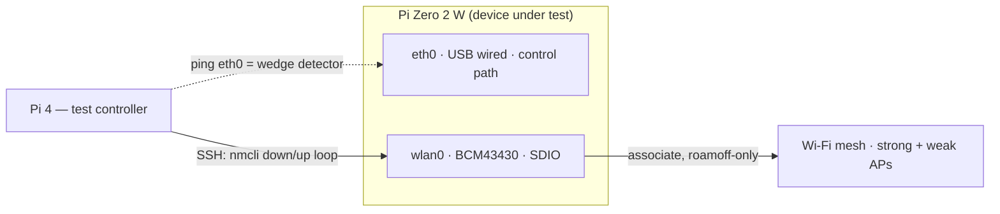

# 詳細トラブルシュート —— Pi Zero 2 W のメッシュ上 Wi-Fi `status_code=16`

[← README へ戻る](../README.ja.md) · 言語：[English](troubleshooting.en.md) · [繁體中文](troubleshooting.zh-TW.md) · **日本語** · [한국어](troubleshooting.ko.md)

> 3 台の Raspberry Pi（Zero 2 W、3B+、Pi 4）を Xiaomi Wi-Fi 7 メッシュ（BE6500 + BE3600）に接続した家庭内デプロイの現場メモ。ホスト固有の秘密情報（Wi-Fi パスワード、SSID、BSSID、内部 IP）はプレースホルダに置換済み。

## 1. 一言で言うと

Zero 2 W の Wi-Fi チップは古い **BCM43430**（ファーム `7.45.96.s1`、2023）。本当に重要なのは 2 つ —— 暗号化と、**ファームのローミングエンジンを無効化すること**:

1. **暗号化 —— 純粋な WPA2-PSK を使う**（下の「暗号化モード」表を参照:純粋な WPA3/SAE は必ず失敗;混在モードは繋がるが不安定）。
2. **ドライバ層:`options brcmfmac roamoff=1`** —— ファームのローミングエンジンを無効化する。これこそ **メッシュのバンドステアリング**（真の主犯）が引っかかる部分。本テスト環境ではこれ単独で **コールド起動の ~88% で強ノードに自動接続**（§7c 参照）—— **BSSID 固定は不要**で、設定も可搬のまま。
3. **（任意 —— 必要な場合のみ）強ノードの BSSID を固定**（`802-11-wireless.bssid AA:BB:CC:DD:EE:FF`）—— これは毎回強 AP を*保証*するが、もろい:ルーターを変えると壊れる（§3 の可搬性ボックス参照）。`roamoff=1` だけでは悪い AP に当たる、またはメッシュが拒否し続ける場合のみ追加する。

### 暗号化モード —— 正確な事実（重要）

| AP 暗号化 | この古いチップでの結果 |
|---|---|
| 純粋 WPA3 / SAE | **必ず失敗**（Zenfone 対照実験で確認:単一 AP が純粋 WPA3 で失敗、純粋 WPA2 で即接続） |
| WPA2/WPA3 **混在** | **繋がるが不安定** —— クライアント（wpa_supplicant）が SAE ではなく PSK を選ぶので*アソシエートできる*。強信号のコールド起動なら ~1–2 秒で接続;弱信号やウォーム再起動では数回の拒否（最大約 4 回、約 35 秒の実測）または失敗。**⚠️ `wpasupplicant` ≤ `2:2.10-24` の場合のみ:`2:2.10-24+rpt3`(2026-11)以降、混在モードは完全に失敗 —— [README の 2026-11 更新](../README.ja.md#2026-11-update) を参照。** |
| 純粋 WPA2 | **信頼できる**（推奨） |

> 注:本デプロイは現在 **roamoff-only（BSSID 固定なし）+ 混在モード暗号化 + 強信号** で運用 —— Wi-Fi は予備リンクで、固定のもろさは割に合わなかった（固定を外した根拠は §7c）。混在モードの不安定をなくしたければ純粋 WPA2 へ。さらに:ここには**ドライバ層の SAE 保護は一切ない** —— `feature_disable` はこのチップで効かない（§3 参照）。よって混在モードで繋がるのは純粋に*クライアント*が PSK を選好するため。(2026-11:混在モードを使い続けるため、本デプロイでは `wpasupplicant` を `2:2.10-24` にダウングレードして hold する必要があった —— [README の更新](../README.ja.md#2026-11-update) を参照。)

## 2. 問題の見分け方

```
wpa_supplicant: wlan0: CTRL-EVENT-ASSOC-REJECT bssid=00:00:00:00:00:00 status_code=16
wpa_supplicant: wlan0: CTRL-EVENT-SSID-TEMP-DISABLED ... auth_failures=N reason=CONN_FAILED
```

- `nmcli con up` が最後に `Secrets were required, but not provided` と言う。これは度重なるアソシエーション失敗後の NetworkManager の**誤解を招く**メッセージで、**パスワードは正しい**。
- `bssid=00:00:00:00:00:00`（オールゼロ）= ファームが 4-way ハンドシェイク**の前**にアソシエーションを拒否 → AP の暗号化/モード非互換であり、認証情報ではない。

AP が実際に広告している内容を確認：

```bash
sudo iw dev wlan0 scan | grep -iA22 'SSID: <YOUR_SSID_2G>' | grep -iE 'RSN|Authentication suites|Capabilities|MFP'
```

| スキャン表示 | 意味 | 古いチップの結果 |
|---|---|---|
| `Authentication suites: PSK SAE` | WPA2/WPA3 **混在**（SAE あり） | 繋がるが不安定 |
| `Authentication suites: SAE` | 純粋 WPA3 | **必ず失敗** |
| `Authentication suites: PSK` | 純粋 WPA2 | **接続可** |

> **⚠️ ルーターのアプリ表示を信じないこと。** メッシュルーターはアプリで「WPA2」と表示しつつ、ビーコンはまだ SAE を広告していることがある ——「WPA2」オプションが WPA3 互換を残す、またはメインルーターを変えたがメッシュのノードが同期していない、など。必ず*クライアント側*で上記スキャンを使って検証する:`Authentication suites: PSK` で、**SAE がない**ことを確認。（SAE が残っている症状:Pi の接続が不安定 —— 強信号では繋がり、弱信号や再起動後は拒否される。）

## 3. 対処（純 WPA2 + roamoff=1；BSSID 固定は任意；Wi-Fi 6/7 は維持可）

**ルーター:** 2.4GHz SSID を**純粋な WPA2-Personal** に（WPA3/混在をオフ）。Wi-Fi 6/7 は有効のままで可。メッシュはなおバンドステアリングするが、クライアントの `roamoff=1` が処理する —— BSSID 固定は*任意*（下記参照）。

**クライアント（デフォルト —— roamoff-only、固定なし）:**

```bash
sudo nmcli con modify "<YOUR_SSID_2G>" \
  802-11-wireless-security.key-mgmt wpa-psk \
  802-11-wireless-security.psk '<YOUR_WIFI_PASSWORD>' \
  802-11-wireless-security.pmf disable \
  connection.autoconnect yes connection.autoconnect-retries 0
sudo nmcli con up "<YOUR_SSID_2G>" ifname wlan0
```

続いてドライバ層の `roamoff=1` を適用（下記「ドライバ層の緩和」参照）—— それがバンドステアリングに本当に勝つステップ。`connection.autoconnect-retries 0` = 無限リトライ（起動時にステアリングが最初の 1～2 回を弾くことがあるが、繋がるまで再試行する）。

**任意 —— 強 AP を固定**（roamoff-only が弱い/誤ったノードに当たり続ける場合のみ）:

```bash
sudo nmcli con modify "<YOUR_SSID_2G>" 802-11-wireless.bssid AA:BB:CC:DD:EE:FF
```

### ⚠️ 可搬性：固定 BSSID は AP のハードに紐づく

BSSID は**特定の AP 無線の MAC アドレス**であり、固定はクライアントをそのハードに縛り付けます。あくまで**バンドステアリング専用**の回避策で、設計上もろい：

| 状況 | 結果 |
|---|---|
| **ルーター/メッシュ変更** | 新 AP は新 MAC → 固定 BSSID が存在せず → 更新するまで Pi は**接続不能** |
| 固定ノードが**電源オフ/移設/故障** | Pi は他ノードへ**ローミングしない**（BSSID 固定 + `roamoff=1`） |
| ルーター**初期化/無線モジュール交換** | MAC が変わり得る → 固定が無効 |

復旧は一行 —— 再スキャンして更新、または固定解除：

```bash
# 新しい強ノードを探す
sudo iw dev wlan0 scan | grep -iB5 'SSID: <YOUR_SSID_2G>' | grep -iE 'BSS|signal'
# それへ更新…
sudo nmcli con modify "<YOUR_SSID_2G>" 802-11-wireless.bssid <NEW_BSSID>
# …または固定を完全解除
sudo nmcli con modify "<YOUR_SSID_2G>" 802-11-wireless.bssid ""
```

**固定が全く要らない場合:**
- **単一 AP（非メッシュ）:** バンドステアリングなし → 純粋 WPA2 + `roamoff=1` で大抵十分。可搬性最良、ルーター変更にも耐える。
- **別のメッシュ:** 新メッシュの強ノードへ固定し直す。
- **最もきれい（AP 側）:** 古い端末用にバンドステアリングを切った/固定ノードに紐づけた専用 SSID を用意 —— クライアントは何も固定せず、端末やファームを替えても壊れない。

### ドライバ層の緩和（推奨）

```
# /etc/modprobe.d/brcmfmac.conf
options brcmfmac roamoff=1
```

`roamoff=1` はファーム内蔵のローミングエンジンを無効化 —— バンドステアリングに直接効く。`sudo modprobe -r brcmfmac && sudo modprobe brcmfmac` で適用、または再起動。反映確認：`cat /sys/module/brcmfmac/parameters/roamoff` → `1`。

> **`feature_disable` についての実測注意。** 多くのフォーラムが
> `options brcmfmac roamoff=1 feature_disable=0x82000`（`0x82000` は SAE + SWSUP の無効化が狙い）を勧めます。**この BCM43430 では観測可能な効果なし** —— `cat /sys/module/brcmfmac/parameters/feature_disable` は**空**を返した（このチップではドライバが sysfs にこのパラメータを出さない）。実測で効いたのは `roamoff=1` だけ。別チップでは結果が異なる可能性あり。

### 試しても無駄なこと（クライアント側）

以下はすべて試したが**効果なし** —— 問題は AP 側であって Pi の設定ではない:

- `nmcli con modify "<YOUR_SSID_2G>" wifi-sec.proto rsn wifi-sec.pairwise ccmp wifi-sec.group ccmp wifi-sec.pmf disable`
- `iw reg set <CC>` / `raspi-config nonint do_wifi_country <CC>`（規制国コードの設定）
- `rfkill unblock` / 繰り返し再接続

クライアント側で効くのは暗号化（純粋 WPA2）と `roamoff=1` の 2 つだけ。それ以外は気を散らすだけ —— AP 側で直し、クライアントのつまみをいじらないこと。

## 4. ハードウェアの文脈 —— 素 vs 改造の Zero 2 W

**素の Zero 2 W は Wi-Fi のみ。** 本デプロイは **USB イーサ HAT**（Waveshare ETH/USB HUB、チップ：Realtek **RTL8152B** USB→10/100、USB hub **FE1.1S**）を追加し、有線 `eth0` を得た。すべて**同一の USB 2.0** を共有（Pi → FE1.1S hub → RTL8152）。影響：

- 最大 100 Mbit（USB 2.0 の上限）—— `eth0 speed=100` は正常。
- hub は Pi から 5V を取る。**電圧降下や接触不良でバス全体が落ちる** —— `eth0` netdev が消えるので、link 状態チェックは `ENOENT` を許容しクラッシュしないこと。
- 有線があれば「**有線を主・Wi-Fi を予備**」（最堅構成）にできる。なければ（多くの読者）、上記 Wi-Fi 対処が唯一の命綱でより重要。

## 5. ファーム版数と「9.88.4.65 へ下げる」罠

実機確認（`dmesg | grep brcmf`）：

```
using brcm/brcmfmac43430-sdio for chip BCM43430/1
Firmware: BCM43430/1 wl0: Jun 14 2023 ... version 7.45.96.s1 (gf031a129)
```

- チップ = **BCM43430/1**（rev 1）、ファーム = **`7.45.96.s1`**（`cypress/cyfmac43430-sdio.bin` を読み込む）。

⚠️ **よく出回る「ファームを 9.88.4.65 へ下げる」（上流 issue #27 由来）は本機には当てはまりません。** あの報告は **BCM43430/2 → 43436** チップ、**9.88.4.x** ファーム系統の話。本機は **BCM43430/1 → 7.45.x** で、まったく別の系統。`9.88.4.65` は本チップに存在せず、別チップの `.bin` を無理に入れると Wi-Fi が完全に壊れ得る。本稿で #27 を引くのは「**なぜメッシュ切替がファームを halt させるか**」の根因出典としてであり、**ダウングレードの指示ではない**。

| | 本機 | issue #27 の機器 |
|---|---|---|
| チップ | BCM43430**/1** | BCM43430**/2**（43436） |
| ファーム系統 | **7.45.x**（`7.45.96.s1`） | **9.88.4.x**（不良 `.77` / 良 `.65`） |
| ファームファイル | `cyfmac43430-sdio.bin` | `brcmfmac43436-sdio.bin` |

## 6. 対照実験

### 6a. Wi-Fi 世代（6/7）は犯人ではない（訂正した誤診）

当初は AP の最新 Wi-Fi モードを疑った。**まず事実:** このネットワークは実は **Wi-Fi 7**（Xiaomi BE シリーズ；Wi-Fi 5 互換をオフにすると 802.11be で動く）。だが Zero 2 W は **802.11n（Wi-Fi 4）** チップ —— レガシーレートでアソシエートし、AP の HE（Wi-Fi 6）/ EHT（Wi-Fi 7）機能は完全に無視する。**最新モードを戻して純粋 WPA2 のままでも、Zero 2 W は接続した —— 再接続は一発成功、再起動でも自動再接続。** よって 1 台の古い端末のために 2.4GHz を Wi-Fi 4/5 に下げ**ない**こと（全 2.4GHz 端末が遅くなる）。Wi-Fi 世代（6 か 7）は犯人ではない —— 維持し、暗号化だけ純粋 WPA2 に。

### 6b. 3 台比較（同じバグ系統、深刻度は別）

| 基板 | チップ / ファーム | 帯域 | 今回起動の `status_code=16` | 結果 |
|---|---|---|---|---|
| **Zero 2 W** | BCM43430 / 7.45.96（旧） | 2.4GHz のみ（ステアリングから逃げられない） | 起動毎に 2–7 回、しばしば再接続失敗 | 対処前 flaky ~60% |
| **Pi 3B+** | BCM4345/6 / 7.45.265 | 5GHz | 4 回（乗り越えた） | ✅ 接続維持 |
| **Pi 4** | BCM4345/6 / 7.45.265 | 5GHz | 0 回 | ✅ 接続維持 |

3B+ も同じ拒否に遭うが乗り越える。新チップ + 新ファーム + 5GHz に居られること（ステアリングの戦場から離れる）で実用上は無問題。**3B+/Pi 4 に `brcmfmac.conf` は不要** —— 壊れていないものを直さない。

### 6c. ドライバ修正 —— 前/後

Wi-Fi 7 + 純粋 WPA2 + BSSID 固定の状態で `roamoff=1` を追加：

| | 前 | 後 |
|---|---|---|
| 起動時の自動接続 | ~60%（40% は完全失敗） | 初回起動 **0 拒否・即接続**；以降の起動も ≤1 拒否で接続 |
| 15× 切断/再接続 | —— | 6/6 接続、拒否は 5→4→3→1→0 と減少 |

正味改善。散発的なステアリング拒否は残る（AP 側の挙動でドライバでは抑えられない）が、クライアントは最終的に必ず接続する —— 予備リンクには十分。

### 6d. ⚠️ wedge：このチップをストレステストしない

**1 日に 2 回、Zero 2 W は基板全体が固まり**、物理的な電源再投入が必要になった（イーサ + SSH も死亡）：

1. 10× 再起動ループ → 8 回目で凍結。
2. 連続切断/再接続 → 6 サイクル目で全システムハング。

根因は上流 **RPi-Distro/firmware-nonfree #27**（「BCM43430/2 firmware stuck when switching between mesh endpoints」）に一致：密なメッシュ再アソシエーションが **Wi-Fi ファームを halt** させ、低電力の Zero 2 W では基板全体のハングに連鎖（USB hub のブラウンアウトも重畳）。2 回とも SD カードは無事（`throttled=0x0`、ext4 エラーなし）—— だが繰り返しの強制電源断自体がリスク。

**このもろさは Zero 2 W 固有。** 対照テスト：**Pi 4 と 3B+ は各 1000× 切断/再接続 → 1000/1000 成功、ファーム halt 0、基板ハング 0。** CYW43455（BCM4345/6、ファーム 7.45.265）は免疫；リトライするだけで halt しない。

### 6e. 訂正後の安全な結論：ゆっくり再接続なら問題なし

wedge は**連続背中合わせ**の再アソシエーションが原因で、再接続そのものではない。**間隔 10 秒以上**なら：100 再接続サイクル → **100/100 PASS、ASSOC-REJECT 0、ハング 0、全程 `throttled=0x0`**、各接続 0–1 秒。よって予備リンクとして通常（連打しない）の使い方なら Wi-Fi は信頼できる。

> ストレス中の傍観メモ：密な Wi-Fi 活動は USB 接続の `eth0`（共有 USB バス）を乱す。真の wedge は「**eth0 と wlan0 が同時に死亡 + ログ凍結**」で判断し、eth0 だけで判断しないこと。

## 7. 後続実験 —— 計装した再接続テスト + eth0「ホスト層 stall」の発見

対処が固まった後、計装をより良くしてもう一巡テストした。この時点で制御役は Pi 3B+ から Pi 4 に移っていた（3B+ は退役準備中）ので、各回は Pi 4 から SSH で駆動し、Zero 2 W はローカルで `nmcli con down/up` ループを回して自分でログを書いた。

**テスト構成** —— Pi 4 がテストを駆動し有線側を監視;Zero 2 W が被試験デバイス:



### 7a. 計装した 100 回テスト 3 巡

各巡 = `nmcli con down → sleep 5 → con up → IP 待ち → sleep N` を 100 サイクル。毎回 PASS/FAIL（IP を取れたか）、再接続時間、`ASSOC-REJECT` 数、`vcgencmd get_throttled` を記録。Pi 4 は同時に「wedge 検出器」を回した —— Zero 2 W の**有線** `eth0` を ping して基板全体のハングを捕まえる。

| 巡 | 巡間隔 | wedge プローブ | wlan 再接続 | ASSOC-REJECT | throttled≠0 | 遅い(>3s) | 基板 wedge |
|-----|------|------|------|------|------|------|------|
| RUN1 | 10s | 単 ping(`-c1 -W2`) | **100/100** | 0 | 0 | 0 | なし |
| RUN2 | 10s | 3 連 ping(`-c3 -W1`) | **100/100** | 0 | 0 | 0 | なし |
| RUN3 | 15s | 3 連 ping(`-c3 -W1`) | **100/100** | 0 | 0 | 0 | なし |

wlan 再接続は 3 巡とも鉄壁（BSSID 固定と roamoff-only の両設定で）。*興味深い*結果は**有線**側だった。

### 7b. eth0 の「切断」はリンク断ではなくホスト層 stall

wedge 検出器は eth0 ping 失敗を記録し続けた —— RUN1（単 ping）88 回;RUN2/RUN3（3 連 ping）57/52 回。それらは**均等に分布し、1 巡に 1 回**で、連続しない。つまり各 wlan0 再アソシエーションのたびに有線 eth0 が ~2-3 秒到達不能になり、その後回復する。

最初の直感（および私の以前のメモ）は共有 USB バスのせいにした:「密な Wi-Fi 活動が USB 接続のイーサ NIC を乱す」。**対照実験がそれを覆した。** wlan0 再接続を 1 回トリガーしつつ eth0 を高頻度サンプリング:

- `eth0 carrier_changes`:**2 → 2（差 0）** —— 物理リンクは一度も flap していない。
- 全期間 `carrier` は `1`、`operstate` は `up` のまま。
- Pi-4 → eth0 の ping 失敗は wlan0 `dormant` 再アソシエーション窓に*正確に*収まる —— しかもリンクは終始落ちていない。

**結論:これは物理リンク断ではない。基板は wlan0 再アソシエーションの ~2-3 秒間、単に eth0 の ICMP に応答しなくなるだけ —— ホスト層 stall。** 考えられる原因:NetworkManager の経路再計算、弱い CPU が `wpa_supplicant`+DHCP で忙しい、そして —— 注目すべきは —— **eth0 と wlan0 が同一サブネット**にあるため、一方を再構成すると共有経路が乱される。これは「USB バス」説も*機構的に*覆す:Zero 2 W では Wi-Fi は **SDIO**、イーサは **USB** —— まったく別のバスだ。同じ stall の下流効果:アプリ層の HTTP 接続プローブ（`generate_204`）が eth0 から出る際に時々タイムアウトする。再アソシエーション中、ホストが一瞬それを処理できないからだ。

1 回の wlan0 再接続のタイムライン（eth0 リンクは終始落ちず、ICMP だけが stall）:

```text
One wlan0 reconnect: eth0 link never drops, only ICMP stalls (~2-3 s)

  t (s):            0      2      4      6      8     10
  wlan0:            |-- up --|dormant|----- up ----|
  eth0 carrier:     |======== 1, never drops ========|   (carrier_changes 2 -> 2)
  Pi4 -> eth0 ping:  OK     OK    FAIL  FAIL  FAIL   OK
                                  \___ eth0 unreachable ~2-3 s ___/
```

> **方法論メモ —— 正しい信号を計測せよ。** 単一の `ping -c1 -W2` は弱い wedge 検出器だ:1 パケット欠落 ≠ リンク断 ≠ ハング。3 連 ping に加え、ルール「*eth0 **と** wlan0 の両方が死に**かつ**デバイス自身のログが進まなくなった時のみ wedge と呼ぶ*」が「wedge vs 良性」の判定を信頼できるものにする。真の wedge は連続した失敗の塊 + ログ凍結;これらは孤立した単巡 blip で、ログは 100 まで進み続けた。

### 7c. roamoff-only —— BSSID 固定は実は不要

元の対処はバンドステアリングを避けるため特定の AP BSSID を固定したが、固定した MAC はもろい（ルーターを変えると壊れる）。そこで**固定を完全に外し**、`roamoff=1` だけに頼って `wpa_supplicant` に AP を選ばせるテストをした:

- 40 再接続サイクル、BSSID 固定なし → **40/40 接続**、**38/40（95%）が自分で強ノードに接続**、弱いノードを選んだ 2 回も問題なく接続、reject があったのは 1 巡のみ。

次に**コールド起動パス**をテストした（`nmcli con down/up` では検証できない —— ファーム/NetworkManager の起動時初期化を飛ばすため）。**合計 41 回再起動、間隔 ≥30 秒:**

- **41/41 起動して戻り、基板 wedge 0**、**ASSOC-REJECT 0**、低電圧 0。
- **~88% が強ノードに自動接続**;残りは*同じ*弱い同 SSID ノード（−63 dBm、まだ使える）に当たった;1 回はサンプリング窓内で接続が遅かっただけ。

代表的な抜粋（サニタイズ済み —— 実際の BSSID/IP は置換）:

```text
reboot  1   PASS   -> strong node    reject=0   throttled=0x0
reboot  8   PASS   -> weak node      reject=0   throttled=0x0   (-63 dBm, still usable)
reboot 30   PASS   -> strong node    reject=0   throttled=0x0
----------------------------------------------------------------
41/41 booted  ·  0 board-wedge  ·  ~88% strong node  ·  0 ASSOC-REJECT  ·  0 undervoltage
```

2 つの要点:

1. **roamoff-only は起動時に確実に自動接続する** —— 通常は強 AP、時々弱い方。よって予備リンクには `roamoff=1` だけで十分;**強 AP を*保証*したい場合のみ BSSID を固定**（固定は毎回強制するが、可搬性を犠牲にする）。
2. **「背中合わせは殺す、間隔があれば安全」のルールは*再起動*にも及ぶ、再接続だけでなく。** 以前、密な再起動ループがこの基板を wedge させた（10 回中 8 回目）が、**間隔 ≥30 秒の 41 回再起動は一度も wedge しなかった**。よって小規模で*間隔のある*再起動テストは安全;高速な再起動ループはそうではない。

総じて:本ネットワークでは `roamoff=1` だけで確実に接続し*かつ*ほぼ強 AP を自己選択する —— **ハード BSSID 固定は外せる**（SSID をアンカーにし、ハードウェア MAC に縛られないので可搬のまま）。特定 AP を保証する必要がある時だけ固定を残す。*（但し書き:これは単一ネットワーク —— n=1。より攻撃的なメッシュには、固定が万能の予備手段として残る。）*

> **関連する注意 —— 強い RSSI ≠ ネットが使える。** メッシュでは、信号が強い AP でも *バックホール* が死んでいたり輻輳していたりして、「アソシエートしたがネットなし」になりうる。RSSI が測るのは *自分 → AP* であって *AP → インターネット* ではない —— だから信号強度（やアソシエーション）だけを信じず、エンドツーエンドで検証する（ゲートウェイへの ping / HTTP `generate_204` 接続チェック、本プロジェクトの監視が既に行っている）。この古いチップは 802.11k/v（インフラがクライアントを不良バックホールのノードから移動させる標準）を使えず、ファームのローミングを戻すと wedge する —— よってクライアントは「到達性を検証し、ローミングを試みない」べき。根本的な対策は AP 側:有線バックホール、またはバンドステアリングを無効化 / 古い端末に良いノードへ紐づけた専用 SSID を与える。

### 7d. 本番環境でのテストに関する注意

これらのテストは意図的に Wi-Fi を flap させ、ノード*自身*の監視を汚染する:レイテンシ/loss/プローブ指標が跳ね上がり、ハートビートのウォッチドッグが誤って down を発報しうる。規律は標準のメンテナンス窓 —— テスト窓についてアラートをサイレンスし、かつ/またはダッシュボードに annotation を付ける —— で、自分が起こした凹みを後で本物のインシデントと誤認しないようにする。

## 8. 出典 —— 外部証拠 vs 自分の実測

### ✅ 上流 issue / フォーラムの裏付けあり
| 結論 | 出典 |
|---|---|
| SAE / WPA2-WPA3 混在は古いチップを弾く | raspberrypi/linux #4976（mixed-mode AP） |
| バンドステアリング / メッシュローミングがファームを halt | RPi-Distro/firmware-nonfree #27、Launchpad #1929746 |
| `roamoff=1` / `feature_disable` は定番の方向 | RPi フォーラム t=384103、blog.wijman.net |
| `status_code=16` は長年の brcmfmac 問題、他者も遭遇 | RPi フォーラム t=377009、fiquett.com |

### ⭐ 自分の実測のみ（外部にない、または外部を訂正）
1. **Wi-Fi 世代（6/7）は無罪** —— 最新モードを戻して純粋 WPA2 で接続できることで証明（古い 802.11n クライアントはどのみち無視する；自分の当初の推測も覆した）。
2. **安全な再接続しきい値 ≥10 秒** —— 100/100 のゆっくり再接続テストで定量化（#27 は「halt する」とだけで、どの密度が危険かは言わない）。
3. **`feature_disable=0x82000` は本チップで無効** —— sysfs 読み出しが空；実測で効いたのは `roamoff=1` のみ。（一般的なフォーラム助言を訂正。）
4. **固定すべき強ノードの BSSID** —— このメッシュ固有。
5. **3 台の深刻度比較 + 1000× 免疫テスト** —— 外部報告は単機；ここではチップを唯一の変数として切り分け。
6. **「基板全体 wedge」は #27 の記述より深刻** —— #27 は「ローミングが壊れる」；ここではファーム halt が eth0 + SSH も道連れにし、電源再投入が必要。
7. **電力/SD を除外** —— wedge 時 `throttled=0x0`、事後 SD 無事。
8. **実機ファーム = 7.45.96.s1（BCM43430/1）** → これより #27 の 9.88.4.65 ダウングレードは不適用と判定。

### 参考リンク
- Raspberry Pi Forums — ASSOC-REJECT bssid 00:00:00 status_code=16: https://forums.raspberrypi.com/viewtopic.php?t=377009
- raspberrypi/linux #4976 — brcmfmac fails to connect to WPA2/WPA3 mixed-mode AP: https://github.com/raspberrypi/linux/issues/4976
- RPi-Distro/firmware-nonfree #34 — ASSOC-REJECT with SWSUP (BCM4345 Rpi3+/4): https://github.com/RPi-Distro/firmware-nonfree/issues/34
- RPi-Distro/firmware-nonfree #27 — Zero 2 W: BCM43430/2 firmware stuck when switching between mesh endpoints: https://github.com/RPi-Distro/firmware-nonfree/issues/27
- Raspberry Pi Forums — brcmfmac.feature_disable=0x82000: https://forums.raspberrypi.com/viewtopic.php?t=384103
- Launchpad #1929746 — RPi Wi-Fi incompatibility with fast roaming (802.11r): https://bugs.launchpad.net/raspbian/+bug/1929746
- blog.wijman.net — Make Raspberry Pi Zero 2 W Wi-Fi work correctly: https://blog.wijman.net/make-raspberry-pi-zero-2w-wifi-work-correctly/
- fiquett.com — RPi5 Wi-Fi rejected by eero status_code=16 (2026-04): https://fiquett.com/2026/04/raspberry-pi-5-wifi-rejected-by-eero-status_code16-and-what-finally-fixed-it/

## 9. 最終状態

- Zero 2 W は `<YOUR_SSID_2G>` に接続 → DHCP 取得、Wi-Fi 7 + 純粋 WPA2、**roamoff-only（BSSID 固定なし）**、`brcmfmac.conf roamoff=1`、autoconnect 無限リトライ。起動時に自動再接続（≤1 拒否で）。
- **有線 `eth0` が主；Wi-Fi は予備。**（素の Wi-Fi のみの基板：Wi-Fi が唯一の経路 —— 対処はより重要。）
- ルーターは **Wi-Fi 7** を維持(無害と実証)。暗号化は:**純粋 WPA2 が最も安定**;純粋 WPA3/SAE は必ず失敗;混在は繋がるが不安定。(本デプロイは予備リンク用に混在モードを維持 —— 鉄壁の安定が欲しければ純粋 WPA2 を推奨。)
