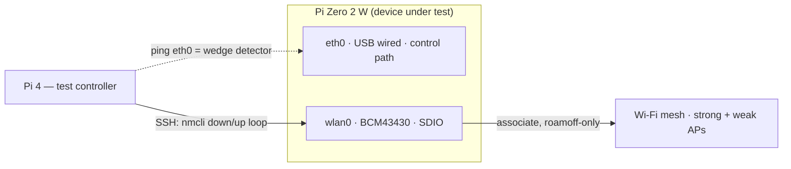

# 전체 문제 해결 기록 —— Pi Zero 2 W의 메시 환경 Wi-Fi `status_code=16`

[← README로 돌아가기](../README.ko.md) · 언어: [English](troubleshooting.en.md) · [繁體中文](troubleshooting.zh-TW.md) · [日本語](troubleshooting.ja.md) · **한국어**

> 라즈베리 파이 3대(Zero 2 W, 3B+, Pi 4)를 Xiaomi Wi-Fi 6 메시(BE6500 + BE3600)에 연결한 가정 배포의 현장 기록. 호스트 고유 비밀 정보(Wi-Fi 비밀번호, SSID, BSSID, 내부 IP)는 플레이스홀더로 치환됨.

## 1. 한 문장 결론

Zero 2 W의 Wi-Fi 칩은 오래된 **BCM43430**(펌웨어 `7.45.96.s1`, 2023). 정말 중요한 것은 두 가지 —— 암호화, 그리고 **펌웨어의 로밍 엔진을 끄는 것**:

1. **암호화 —— 순수 WPA2-PSK 사용**(아래 "암호화 모드" 표 참고: 순수 WPA3/SAE는 항상 실패, 혼합 모드는 연결되지만 불안정).
2. **드라이버 계층: `options brcmfmac roamoff=1`** —— 펌웨어 로밍 엔진을 끄며, 바로 그것이 **메시 밴드 스티어링**(진짜 주범)이 걸리는 지점. 이 테스트 네트워크에서는 이것만으로 **콜드 부팅의 ~88%에서 강한 노드에 자동 연결**(§7c 참고) —— **BSSID 고정 불필요**, 설정도 이식성 유지.
3. **(선택 —— 필요할 때만) 강한 노드의 BSSID 고정**(`802-11-wireless.bssid AA:BB:CC:DD:EE:FF`) —— 매번 강한 AP를 *보장*하지만 취약함: 공유기를 바꾸면 깨짐(§3의 이식성 박스 참고). `roamoff=1`만으로 나쁜 AP에 걸리거나 메시가 계속 거부할 때만 추가.

### 암호화 모드 — 정확한 사실 (중요)

| AP 암호화 | 이 오래된 칩에서의 결과 |
|---|---|
| 순수 WPA3 / SAE | **항상 실패** (Zenfone 대조 실험으로 확정) |
| WPA2/WPA3 **혼합** | **연결 가능하지만 불안정** —— 클라이언트(wpa_supplicant)가 SAE 대신 PSK를 협상하므로 연결은 됨. 단 강신호 콜드 부팅에서는 ~1–2초로 잘 되지만, 약신호나 웜 재부팅에서는 여러 번 거부(최대 4회·35초)되거나 실패 |
| 순수 WPA2 | **안정적** (권장) |

> 참고: 이 배포는 현재 **roamoff-only(BSSID 고정 없음) + 혼합 모드 암호화 + 강신호** 로 운용 —— Wi-Fi는 예비 링크이고 고정의 취약성이 그만한 가치가 없었음(고정을 뺀 근거는 §7c). 혼합 모드의 불안정을 없애려면 순수 WPA2로.

## 2. 문제 식별

```
wpa_supplicant: wlan0: CTRL-EVENT-ASSOC-REJECT bssid=00:00:00:00:00:00 status_code=16
wpa_supplicant: wlan0: CTRL-EVENT-SSID-TEMP-DISABLED ... auth_failures=N reason=CONN_FAILED
```

- `nmcli con up` 가 마지막에 `Secrets were required, but not provided` 라고 함. 이는 거듭된 association 실패 후 NetworkManager의 **오해 소지가 있는** 메시지로, **비밀번호는 맞습니다**.
- `bssid=00:00:00:00:00:00`(전부 0) = 펌웨어가 4-way 핸드셰이크 **이전**에 association을 거부 → AP 암호화/모드 비호환이며 자격 증명이 아님.

AP가 실제로 광고하는 내용 확인:

```bash
sudo iw dev wlan0 scan | grep -iA22 'SSID: <YOUR_SSID_2G>' | grep -iE 'RSN|Authentication suites|Capabilities|MFP'
```

| 스캔 표시 | 의미 | 오래된 칩 결과 |
|---|---|---|
| `Authentication suites: PSK SAE` | WPA2/WPA3 **혼합**(SAE 포함) | 연결되지만 불안정 |
| `Authentication suites: SAE` | 순수 WPA3 | **항상 실패** |
| `Authentication suites: PSK` | 순수 WPA2 | **안정적으로 연결** |

## 3. 해결(순수 WPA2 + roamoff=1; BSSID 고정 선택; Wi-Fi 6 유지 가능)

**공유기:** 2.4GHz SSID를 **순수 WPA2-Personal** 로(WPA3/혼합 끄기). Wi-Fi 6은 유지 가능. 메시는 여전히 밴드 스티어링하지만 클라이언트의 `roamoff=1`이 처리함 —— BSSID 고정은 *선택*(아래 참고).

**클라이언트(기본 —— roamoff-only, 고정 없음):**

```bash
sudo nmcli con modify "<YOUR_SSID_2G>" \
  802-11-wireless-security.key-mgmt wpa-psk \
  802-11-wireless-security.psk '<YOUR_WIFI_PASSWORD>' \
  802-11-wireless-security.pmf disable \
  connection.autoconnect yes connection.autoconnect-retries 0
sudo nmcli con up "<YOUR_SSID_2G>" ifname wlan0
```

이어서 드라이버 계층 `roamoff=1`을 적용(아래 "드라이버 계층 완화" 참고) —— 그것이 밴드 스티어링을 실제로 이기는 단계. `connection.autoconnect-retries 0` = 무한 재시도(부팅 시 스티어링이 처음 1~2회를 막을 수 있으나 연결될 때까지 재시도함).

**선택 —— 강한 AP 고정**(roamoff-only가 약하거나 잘못된 노드에 계속 걸릴 때만):

```bash
sudo nmcli con modify "<YOUR_SSID_2G>" 802-11-wireless.bssid AA:BB:CC:DD:EE:FF
```

### ⚠️ 이식성: 고정된 BSSID는 AP 하드웨어에 묶임

BSSID는 **특정 AP 무선의 MAC 주소**이므로, 고정은 클라이언트를 그 하드웨어에 묶습니다. 어디까지나 **밴드 스티어링 전용** 우회책이며 설계상 취약합니다:

| 상황 | 결과 |
|---|---|
| **공유기/메시 교체** | 새 AP는 새 MAC → 고정 BSSID가 존재하지 않음 → 갱신 전까지 Pi **연결 불가** |
| 고정 노드가 **꺼짐/이동/고장** | Pi는 다른 노드로 **로밍하지 않음**(BSSID 고정 + `roamoff=1`) |
| 공유기 **초기화/무선 모듈 교체** | MAC이 바뀔 수 있음 → 고정 무효 |

복구는 한 줄 —— 다시 스캔해 갱신하거나 고정 해제:

```bash
# 새 강한 노드 찾기
sudo iw dev wlan0 scan | grep -iB5 'SSID: <YOUR_SSID_2G>' | grep -iE 'BSS|signal'
# 그것으로 갱신…
sudo nmcli con modify "<YOUR_SSID_2G>" 802-11-wireless.bssid <NEW_BSSID>
# …또는 고정을 완전히 해제
sudo nmcli con modify "<YOUR_SSID_2G>" 802-11-wireless.bssid ""
```

**고정이 전혀 필요 없는 경우:**
- **단일 AP(비메시):** 밴드 스티어링 없음 → 순수 WPA2 + `roamoff=1` 로 보통 충분. 이식성 최상, 공유기 교체에도 견딤.
- **다른 메시:** 새 메시의 강한 노드로 다시 고정해야 함.
- **가장 깔끔(AP 측):** 오래된 클라이언트용으로 밴드 스티어링을 끈/고정 노드에 묶은 전용 SSID 제공 —— 클라이언트는 아무것도 고정하지 않고, 클라이언트나 펌웨어를 바꿔도 깨지지 않음.

### 드라이버 계층 완화(권장)

```
# /etc/modprobe.d/brcmfmac.conf
options brcmfmac roamoff=1
```

`roamoff=1` 은 펌웨어 내장 로밍 엔진을 끔 —— 밴드 스티어링에 직접 작용. `sudo modprobe -r brcmfmac && sudo modprobe brcmfmac` 로 적용하거나 재부팅. 적용 확인: `cat /sys/module/brcmfmac/parameters/roamoff` → `1`.

> **`feature_disable`에 대한 실측 주의.** 많은 포럼이
> `options brcmfmac roamoff=1 feature_disable=0x82000`(`0x82000`은 SAE + SWSUP 비활성화 의도)을 권합니다. **이 BCM43430에서는 관측 가능한 효과 없음** —— `cat /sys/module/brcmfmac/parameters/feature_disable` 가 **비어 있게** 반환됨(이 칩에서는 드라이버가 sysfs로 이 파라미터를 노출하지 않음). 실측으로 효과가 있던 것은 `roamoff=1` 뿐. 다른 칩에서는 결과가 다를 수 있음.

## 4. 하드웨어 맥락 —— 기본 vs 개조한 Zero 2 W

**기본 Zero 2 W는 Wi-Fi 전용.** 이 배포는 **USB 이더넷 HAT**(Waveshare ETH/USB HUB, 칩셋: Realtek **RTL8152B** USB→10/100, USB 허브 **FE1.1S**)를 추가해 유선 `eth0` 를 얻음. 모두 **동일한 USB 2.0** 을 공유(Pi → FE1.1S 허브 → RTL8152). 영향:

- 최대 100 Mbit(USB 2.0 상한) —— `eth0 speed=100` 은 정상.
- 허브는 Pi에서 5V를 끌어옴. **전압 강하나 접촉 불량으로 버스 전체가 끊김** —— `eth0` netdev가 사라지므로, link 상태 점검은 `ENOENT` 를 허용하고 크래시하지 말 것.
- 이더넷이 있으면 "**유선 우선, Wi-Fi 예비**"(가장 견고) 운용 가능. 없으면(대부분의 독자) 위의 Wi-Fi 해결책이 유일한 생명줄이라 더 중요.

## 5. 펌웨어 버전과 "9.88.4.65로 다운그레이드" 함정

실기기 확인(`dmesg | grep brcmf`):

```
using brcm/brcmfmac43430-sdio for chip BCM43430/1
Firmware: BCM43430/1 wl0: Jun 14 2023 ... version 7.45.96.s1 (gf031a129)
```

- 칩 = **BCM43430/1**(rev 1), 펌웨어 = **`7.45.96.s1`**(`cypress/cyfmac43430-sdio.bin` 로드).

⚠️ **널리 회자되는 "펌웨어 9.88.4.65로 다운그레이드"(업스트림 issue #27 출처)는 이 보드에 적용되지 않습니다.** 그 보고는 **BCM43430/2 → 43436** 칩, **9.88.4.x** 펌웨어 계통 이야기. 이 보드는 **BCM43430/1 → 7.45.x** 로 완전히 다른 계통. `9.88.4.65` 는 이 칩에 존재하지 않으며, 다른 칩의 `.bin` 을 억지로 넣으면 Wi-Fi가 완전히 망가질 수 있음. 본문에서 #27을 인용하는 것은 "**왜 메시 전환이 펌웨어를 halt시키는가**"의 근본 원인 출처로서이며, **다운그레이드 지시가 아님**.

| | 이 보드 | issue #27의 기기 |
|---|---|---|
| 칩 | BCM43430**/1** | BCM43430**/2**(43436) |
| 펌웨어 계통 | **7.45.x**(`7.45.96.s1`) | **9.88.4.x**(불량 `.77` / 양호 `.65`) |
| 펌웨어 파일 | `cyfmac43430-sdio.bin` | `brcmfmac43436-sdio.bin` |

## 6. 대조 실험

### 6a. Wi-Fi 6은 범인이 아니다(정정한 오진)

처음엔 Wi-Fi 6(802.11ax/HE)을 의심했음. **Wi-Fi 6을 다시 켜고 순수 WPA2를 유지해도 Zero 2 W는 연결됨 —— 재연결 첫 시도 성공, 재부팅 시에도 자동 재연결.** 따라서 오래된 클라이언트 하나 때문에 2.4GHz를 Wi-Fi 4/5로 낮추지 **말 것**(모든 2.4GHz 기기가 느려짐). Wi-Fi 6은 유지하고 암호화만 순수 WPA2로.

### 6b. 3대 비교(같은 버그 계열, 심각도는 다름)

| 보드 | 칩 / 펌웨어 | 대역 | 이번 부팅 `status_code=16` | 결과 |
|---|---|---|---|---|
| **Zero 2 W** | BCM43430 / 7.45.96(구) | 2.4GHz 전용(스티어링 못 피함) | 부팅마다 2–7회, 자주 재연결 실패 | 수정 전 flaky ~60% |
| **Pi 3B+** | BCM4345/6 / 7.45.265 | 5GHz | 4회(스스로 견딤) | ✅ 연결 유지 |
| **Pi 4** | BCM4345/6 / 7.45.265 | 5GHz | 0회 | ✅ 연결 유지 |

3B+도 같은 거부를 겪지만 견뎌냄. 새 칩 + 새 펌웨어 + 5GHz에 머물 수 있음(스티어링 전장에서 벗어남)으로 실용상 무문제. **3B+/Pi 4에는 `brcmfmac.conf` 불필요** —— 멀쩡한 걸 고치지 말 것.

### 6c. 드라이버 수정 —— 전/후

Wi-Fi 6 + 순수 WPA2 + BSSID 고정 상태에서 `roamoff=1` 추가:

| | 전 | 후 |
|---|---|---|
| 부팅 시 자동 연결 | ~60%(40%는 완전 실패) | 첫 부팅 **0 거부·즉시 연결**; 이후 부팅도 ≤1 거부로 연결 |
| 15× 끊김/재연결 | —— | 6/6 연결, 거부 5→4→3→1→0 감소 |

순 개선. 산발적 스티어링 거부는 남음(AP 측 동작이라 드라이버로 못 막음)이나 클라이언트는 결국 항상 연결됨 —— 예비 링크로는 충분.

### 6d. ⚠️ wedge: 이 칩을 스트레스 테스트하지 말 것

**하루에 두 번 Zero 2 W가 보드 전체가 멈춰** 물리적 전원 재투입이 필요했음(이더넷 + SSH도 죽음):

1. 10× 재부팅 루프 → 8회차에서 동결.
2. 연속 끊김/재연결 → 6 사이클째 전체 시스템 행.

근본 원인은 업스트림 **RPi-Distro/firmware-nonfree #27**("BCM43430/2 firmware stuck when switching between mesh endpoints")과 일치: 조밀한 메시 재association이 **Wi-Fi 펌웨어를 halt**시키고, 저전력 Zero 2 W에서는 보드 전체 행으로 연쇄됨(USB 허브 브라운아웃까지 중첩). 두 번 다 SD 카드는 무사(`throttled=0x0`, ext4 오류 없음) —— 그러나 반복적인 강제 전원 차단 자체가 위험.

**이 취약성은 Zero 2 W 고유.** 대조 테스트: **Pi 4와 3B+는 각각 1000× 끊김/재연결 → 1000/1000 성공, 펌웨어 halt 0, 보드 행 0.** CYW43455(BCM4345/6, 펌웨어 7.45.265)는 면역; 재시도만 할 뿐 halt하지 않음.

### 6e. 정정된 안전 결론: 느린 재연결은 문제없음

wedge는 **연속 배경 맞댐** 재association이 원인이지 재연결 자체가 아님. **간격 10초 이상**이면: 100 재연결 사이클 → **100/100 PASS, ASSOC-REJECT 0, 행 0, 전 구간 `throttled=0x0`**, 각 연결 0–1초. 따라서 예비 링크로서 정상적(연타하지 않는) 사용이면 Wi-Fi는 신뢰할 수 있음.

> 스트레스 중 관찰 메모: 조밀한 Wi-Fi 활동은 USB 연결 `eth0`(공유 USB 버스)를 교란함. 진짜 wedge는 "**eth0와 wlan0가 동시에 죽고 + 로그 동결**"로 판단하고 eth0만으로 판단하지 말 것.

## 7. 후속 실험 —— 계측된 재연결 테스트 + eth0 "호스트 계층 stall" 발견

해결책이 정해진 후 계측을 더 잘 갖춰 한 차례 더 테스트했다. 이 시점에 제어 노드는 Pi 3B+에서 Pi 4로 옮겨졌으므로(3B+는 퇴역 준비 중), 모든 회차는 Pi 4에서 SSH로 구동하고 Zero 2 W는 로컬에서 `nmcli con down/up` 루프를 돌리며 자체 로그를 기록했다.

**테스트 구성** —— Pi 4가 테스트를 구동하고 유선 쪽을 감시; Zero 2 W가 피시험 장치:



### 7a. 계측된 100회 테스트 3차

각 회차 = `nmcli con down → sleep 5 → con up → IP 대기 → sleep N` 100 사이클. 매 회차 PASS/FAIL(IP를 받았는가), 재연결 시간, `ASSOC-REJECT` 수, `vcgencmd get_throttled` 기록. Pi 4는 동시에 "wedge 감지기"를 돌림 —— Zero 2 W의 **유선** `eth0`에 ping하여 보드 전체 hang을 포착.

| 회차 | 회차 간격 | wedge 프로브 | wlan 재연결 | ASSOC-REJECT | throttled≠0 | 느림(>3s) | 보드 wedge |
|-----|------|------|------|------|------|------|------|
| RUN1 | 10s | 단일 ping(`-c1 -W2`) | **100/100** | 0 | 0 | 0 | 없음 |
| RUN2 | 10s | 3연속 ping(`-c3 -W1`) | **100/100** | 0 | 0 | 0 | 없음 |
| RUN3 | 15s | 3연속 ping(`-c3 -W1`) | **100/100** | 0 | 0 | 0 | 없음 |

wlan 재연결은 세 차례 모두 견고(고정 BSSID와 roamoff-only 두 설정 모두). *흥미로운* 결과는 **유선** 쪽이었다.

### 7b. eth0 "단절"은 링크 끊김이 아니라 호스트 계층 stall

wedge 감지기는 eth0 ping 실패를 계속 기록했다 —— RUN1(단일 ping) 88회; RUN2/RUN3(3연속 ping) 57/52회. 그것들은 **고르게 분포, 회차당 1회**이고 연속되지 않는다. 즉 각 wlan0 재association마다 유선 eth0가 ~2-3초 도달 불가가 되었다가 회복한다.

첫 직감(그리고 내 이전 메모)은 공유 USB 버스를 탓했다: "조밀한 Wi-Fi 활동이 USB 연결 이더넷 NIC를 교란한다." **대조 실험이 그것을 뒤집었다.** wlan0 재연결을 1회 트리거하면서 eth0를 고빈도로 샘플링:

- `eth0 carrier_changes`: **2 → 2(차이 0)** —— 물리 링크는 한 번도 flap하지 않음.
- 전체 구간 `carrier`는 `1`, `operstate`는 `up` 유지.
- Pi-4 → eth0 ping 실패는 wlan0 `dormant` 재association 창에 *정확히* 들어맞음 —— 그런데 링크는 내내 끊기지 않음.

**결론: 이것은 물리 링크 끊김이 아니다. 보드가 wlan0 재association 동안 ~2-3초간 단순히 eth0의 ICMP에 응답을 멈출 뿐 —— 호스트 계층 stall.** 가능한 원인: NetworkManager의 경로 재계산, 약한 CPU가 `wpa_supplicant`+DHCP로 바쁨, 그리고 —— 주목할 점 —— **eth0와 wlan0가 같은 서브넷**에 있어 한쪽을 재구성하면 공유 경로가 교란됨. 이는 "USB 버스" 설도 *기구적으로* 뒤집는다: Zero 2 W에서 Wi-Fi는 **SDIO**, 이더넷은 **USB** —— 완전히 다른 버스다. 같은 stall의 하류 효과: 애플리케이션 계층 HTTP 연결성 프로브(`generate_204`)가 eth0로 나갈 때 가끔 타임아웃 —— 재association 중 호스트가 잠시 처리하지 못해서다.

한 번의 wlan0 재연결 타임라인(eth0 링크는 내내 안 끊기고 ICMP만 stall):

```text
One wlan0 reconnect: eth0 link never drops, only ICMP stalls (~2-3 s)

  t (s):            0      2      4      6      8     10
  wlan0:            |-- up --|dormant|----- up ----|
  eth0 carrier:     |======== 1, never drops ========|   (carrier_changes 2 -> 2)
  Pi4 -> eth0 ping:  OK     OK    FAIL  FAIL  FAIL   OK
                                  \___ eth0 unreachable ~2-3 s ___/
```

> **방법론 메모 —— 올바른 신호를 계측하라.** 단일 `ping -c1 -W2`는 약한 wedge 감지기다: 패킷 1개 누락 ≠ 링크 끊김 ≠ hang. 3연속 ping에 더해 규칙 "*eth0 **와** wlan0가 둘 다 죽고 **또한** 장치 자체 로그가 더 이상 진행하지 않을 때만 wedge로 본다*"가 "wedge vs 양성" 판정을 신뢰할 수 있게 만든다. 진짜 wedge는 지속적 실패 덩어리 + 로그 정지; 이것들은 고립된 단일 회차 blip이고 로그는 100까지 진행했다.

### 7c. roamoff-only —— BSSID 고정은 사실 불필요

원래 해결책은 밴드 스티어링을 피하려 특정 AP BSSID를 고정했지만, 고정된 MAC은 취약하다(공유기를 바꾸면 깨짐). 그래서 **고정을 완전히 빼고** `roamoff=1`만으로 `wpa_supplicant`가 AP를 고르게 하는 테스트를 했다:

- 40 재연결 사이클, BSSID 고정 없음 → **40/40 연결**, **38/40(95%)이 스스로 강한 노드에 연결**, 약한 노드를 고른 2회도 정상 연결, reject가 있었던 건 1회뿐.

다음으로 **콜드 부팅 경로**를 테스트했다(`nmcli con down/up`로는 검증 불가 —— 펌웨어/NetworkManager 부팅 초기화를 건너뜀). **총 41회 재부팅, 간격 ≥30초:**

- **41/41 부팅 복귀, 보드 wedge 0**, **ASSOC-REJECT 0**, 저전압 0.
- **~88%가 강한 노드에 자동 연결**; 나머지는 *같은* 약한 동일 SSID 노드(−63 dBm, 여전히 사용 가능)에 걸림; 한 번은 샘플링 창 내에서 연결이 느렸을 뿐.

대표 발췌(새니타이즈됨 —— 실제 BSSID/IP는 치환):

```text
reboot  1   PASS   -> strong node    reject=0   throttled=0x0
reboot  8   PASS   -> weak node      reject=0   throttled=0x0   (-63 dBm, still usable)
reboot 30   PASS   -> strong node    reject=0   throttled=0x0
----------------------------------------------------------------
41/41 booted  ·  0 board-wedge  ·  ~88% strong node  ·  0 ASSOC-REJECT  ·  0 undervoltage
```

두 가지 요점:

1. **roamoff-only는 부팅 시 안정적으로 자동 연결한다** —— 보통 강한 AP, 가끔 약한 쪽. 따라서 예비 링크에는 `roamoff=1`만으로 충분; **강한 AP를 *보장*해야 할 때만 BSSID 고정**(고정은 매번 강제하지만 이식성을 희생).
2. **"등 맞댄 연속은 죽이고, 간격이 있으면 안전"이라는 규칙은 재연결뿐 아니라 *재부팅*에도 적용된다.** 이전에 조밀한 재부팅 루프가 이 보드를 wedge시켰지만(10회 중 8회차), **간격 ≥30초의 41회 재부팅은 한 번도 wedge하지 않았다**. 따라서 소규모의 *간격 있는* 재부팅 테스트는 안전; 빠른 재부팅 루프는 그렇지 않다.

종합: 이 네트워크에서 `roamoff=1`만으로 안정적으로 연결하고 *또한* 대부분 강한 AP를 스스로 선택 —— **하드 BSSID 고정은 뺄 수 있다**(SSID를 기준으로 하고 하드웨어 MAC에 묶이지 않으므로 이식성 유지). 특정 AP를 보장해야 할 때만 고정을 남긴다. *(단서: 이는 단일 네트워크 —— n=1. 더 공격적인 메시에는 고정이 범용 예비 수단으로 남는다.)*

> **관련 주의 —— 강한 RSSI ≠ 인터넷 됨.** 메시에서는 신호가 강한 AP라도 *백홀*이 죽었거나 혼잡해 "association은 됐지만 인터넷 없음"이 될 수 있다. RSSI는 *나 → AP*를 측정할 뿐 *AP → 인터넷*이 아니다 —— 그러니 신호 세기(나 association)만 믿지 말고 종단 간 검증을 하라(게이트웨이 ping / HTTP `generate_204` 연결성 체크, 이 프로젝트의 모니터링이 이미 수행). 이 오래된 칩은 802.11k/v(인프라가 클라이언트를 나쁜 백홀 노드에서 옮기게 하는 표준)를 쓸 수 없고, 펌웨어 로밍을 다시 켜면 wedge된다 —— 따라서 클라이언트는 "도달성을 검증하되 로밍을 시도하지 않아야" 한다. 근본 해결은 AP 측: 유선 백홀, 또는 밴드 스티어링 끄기 / 오래된 클라이언트에 좋은 노드에 묶인 전용 SSID 제공.

### 7d. 운영 환경 테스트에 관한 주의

이 테스트들은 의도적으로 Wi-Fi를 flap시켜 노드 *자신*의 모니터링을 오염시킨다: 지연/loss/프로브 지표가 치솟고 하트비트 워치독이 거짓 "down"을 발생시킬 수 있다. 규율은 표준 유지보수 창 —— 테스트 창에 대해 알림을 silence하고/또는 대시보드에 annotation을 단다 —— 으로, 스스로 만든 함몰을 나중에 진짜 인시던트로 오인하지 않게 한다.

## 8. 출처 —— 외부 증거 vs 직접 측정

### ✅ 업스트림 issue / 포럼 뒷받침 있음
| 결론 | 출처 |
|---|---|
| SAE / WPA2-WPA3 혼합이 오래된 칩을 막음 | raspberrypi/linux #4976(mixed-mode AP) |
| 밴드 스티어링 / 메시 로밍이 펌웨어 halt | RPi-Distro/firmware-nonfree #27, Launchpad #1929746 |
| `roamoff=1` / `feature_disable` 가 정석 방향 | RPi 포럼 t=384103, blog.wijman.net |
| `status_code=16` 은 오랜 brcmfmac 문제, 타인도 겪음 | RPi 포럼 t=377009, fiquett.com |

### ⭐ 직접 측정만(외부에 없거나 외부를 정정)
1. **Wi-Fi 6은 무죄** —— Wi-Fi 6을 다시 켜고 순수 WPA2로 연결됨을 보여 증명(내 최초 추측도 뒤집음).
2. **안전 재연결 임계 ≥10초** —— 100/100 느린 재연결 테스트로 정량화(#27은 "halt한다"고만 하고 어느 밀도가 위험한지는 말하지 않음).
3. **`feature_disable=0x82000` 이 이 칩에서 무효** —— sysfs 읽기가 비어 있음; 실측 효과는 `roamoff=1` 뿐. (흔한 포럼 조언을 정정.)
4. **고정할 강한 노드의 BSSID** —— 이 메시 고유.
5. **3대 심각도 비교 + 1000× 면역 테스트** —— 외부 보고는 단일 기기; 여기서는 칩을 유일 변수로 분리.
6. **"보드 전체 wedge"는 #27 서술보다 심각** —— #27은 "로밍이 깨짐"; 여기선 펌웨어 halt가 eth0 + SSH까지 끌고 죽어 전원 재투입 필요.
7. **전력/SD 배제** —— wedge 시 `throttled=0x0`, 사후 SD 무사.
8. **실기기 펌웨어 = 7.45.96.s1(BCM43430/1)** → 이로써 #27의 9.88.4.65 다운그레이드는 부적용으로 판정.

### 참고 링크
- Raspberry Pi Forums — ASSOC-REJECT bssid 00:00:00 status_code=16: https://forums.raspberrypi.com/viewtopic.php?t=377009
- raspberrypi/linux #4976 — brcmfmac fails to connect to WPA2/WPA3 mixed-mode AP: https://github.com/raspberrypi/linux/issues/4976
- RPi-Distro/firmware-nonfree #34 — ASSOC-REJECT with SWSUP (BCM4345 Rpi3+/4): https://github.com/RPi-Distro/firmware-nonfree/issues/34
- RPi-Distro/firmware-nonfree #27 — Zero 2 W: BCM43430/2 firmware stuck when switching between mesh endpoints: https://github.com/RPi-Distro/firmware-nonfree/issues/27
- Raspberry Pi Forums — brcmfmac.feature_disable=0x82000: https://forums.raspberrypi.com/viewtopic.php?t=384103
- Launchpad #1929746 — RPi Wi-Fi incompatibility with fast roaming (802.11r): https://bugs.launchpad.net/raspbian/+bug/1929746
- blog.wijman.net — Make Raspberry Pi Zero 2 W Wi-Fi work correctly: https://blog.wijman.net/make-raspberry-pi-zero-2w-wifi-work-correctly/
- fiquett.com — RPi5 Wi-Fi rejected by eero status_code=16 (2026-04): https://fiquett.com/2026/04/raspberry-pi-5-wifi-rejected-by-eero-status_code16-and-what-finally-fixed-it/

## 9. 최종 상태

- Zero 2 W가 `<YOUR_SSID_2G>` 에 연결 → DHCP 획득, Wi-Fi 6 + (이 배포는 혼합 모드 운용, 순수 WPA2 권장), BSSID 고정, `brcmfmac.conf roamoff=1`, autoconnect 무한 재시도. 부팅 시 자동 재연결.
- **유선 `eth0` 가 주; Wi-Fi는 예비.**(기본 Wi-Fi 전용 보드: Wi-Fi가 유일한 연결 —— 해결책이 더 중요.)
- 공유기는 **Wi-Fi 6** 유지(Wi-Fi 6은 무해 입증). 암호화는 **순수 WPA2가 가장 안정적**; 순수 WPA3/SAE는 항상 실패; 혼합은 연결되지만 불안정.
