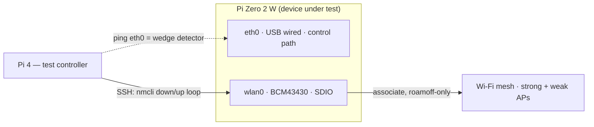

# 完整排錯 writeup —— Pi Zero 2 W 在 mesh 上的 Wi-Fi `status_code=16`

[← 回 README](../README.zh-TW.md) · 語言:[English](troubleshooting.en.md) · **繁體中文** · [日本語](troubleshooting.ja.md) · [한국어](troubleshooting.ko.md)

> 這是三台樹莓派(Zero 2 W、3B+、Pi 4)掛在小米 Wi-Fi 7 mesh(BE6500 + BE3600)上的家用實戰筆記。跟自家有關的機密(Wi-Fi 密碼、SSID、BSSID、內網 IP)都換成佔位符了。

## 1. 一句話結論

Zero 2 W 用的是老晶片 **BCM43430**(韌體 `7.45.96.s1`,2023)。說穿了就兩件事要顧——加密,還有**把韌體的漫遊引擎關掉**:

1. **加密——用純 WPA2-PSK**(下面「加密模式」表會講:純 WPA3/SAE 一定連不上;混合模式連得上但時好時壞)。
2. **驅動層:`options brcmfmac roamoff=1`** —— 把韌體的漫遊引擎關掉,**mesh band steering**(真正的主兇)卡的就是這個。我這個網實測,**光靠它就有 ~88% 的冷開機自己連上強節點**(見 §7c)—— 根本**不用去硬鎖 BSSID**,設定也比較好搬。
3. **(可有可無——真的有需要再用)鎖一個強節點 BSSID**(`802-11-wireless.bssid AA:BB:CC:DD:EE:FF`)—— 它能**保證**每次都連到強 AP,但很脆:你一換路由器它就掛了(見 §3 的可攜性那段)。除非 roamoff 還是一直給你連到爛 AP、或你家 mesh 一直 reject,不然別加。

### 加密模式 —— 精確事實(重要)

| AP 加密 | 這顆老晶片的結果 |
|---|---|
| 純 WPA3 / SAE | **必定失敗**(Zenfone 對照實驗確認:單一 AP 純 WPA3 失敗、純 WPA2 秒連) |
| WPA2/WPA3 **混合** | **連得上但時好時壞** —— 客戶端(wpa_supplicant)協商 PSK 而非 SAE,所以*能*關聯。訊號強冷開機 ~1–2 秒連上;訊號弱或熱重開要被擋好幾次(最多約 4 次、實測拖到約 35 秒)甚至失敗。 |
| 純 WPA2 | **可靠**(建議) |

> 註:我自己這台現在就是 **roamoff-only(沒鎖 BSSID)+ 混合加密 + 訊號夠強**——反正 Wi-Fi 只是備援,鎖 BSSID 太脆、不划算(為什麼拆掉看 §7c)。想連混合模式那點不穩也根除,就改純 WPA2。另外提醒:這台**驅動層沒有任何擋 SAE 的保護**——`feature_disable` 在這顆晶片不生效(見 §3),所以混合模式連得上,純粹是*客戶端*自己挑了 PSK。

## 2. 怎麼認出這個問題

```
wpa_supplicant: wlan0: CTRL-EVENT-ASSOC-REJECT bssid=00:00:00:00:00:00 status_code=16
wpa_supplicant: wlan0: CTRL-EVENT-SSID-TEMP-DISABLED ... auth_failures=N reason=CONN_FAILED
```

- `nmcli con up` 最後會說 `Secrets were required, but not provided`。這是 NetworkManager 在關聯失敗一堆次之後**亂講**的——**密碼根本沒錯**。
- `bssid=00:00:00:00:00:00`(全零)= 韌體在 4-way 握手**之前**就把你擋掉了 → 是 AP 的加密/模式不合,不是帳密問題。

看一下 AP 到底在廣播什麼:

```bash
sudo iw dev wlan0 scan | grep -iA22 'SSID: <YOUR_SSID_2G>' | grep -iE 'RSN|Authentication suites|Capabilities|MFP'
```

| Scan 顯示 | 意義 | 老晶片結果 |
|---|---|---|
| `Authentication suites: PSK SAE` | WPA2/WPA3 **混合**(含 SAE) | 連得上但時好時壞 |
| `Authentication suites: SAE` | 純 WPA3 | **必定失敗** |
| `Authentication suites: PSK` | 純 WPA2 | **可以連** |

> **⚠️ 別信路由器 App 上寫的。** mesh 路由器很常 App 顯示「WPA2」,但 beacon 其實還在放 SAE——「WPA2」那個選項底下常常還留著 WPA3 相容,或是你只改了主路由、某台 mesh 子節點沒跟著同步。一定要*自己從客戶端*用上面那條 scan 驗:要看到 `Authentication suites: PSK`、**不能有** `SAE` 才算數。(SAE 還在的話,症狀就是時好時壞——訊號強偶爾連得上、弱一點或一重開就被 reject。)

## 3. 修法(純 WPA2 + roamoff=1;鎖 BSSID 可有可無;Wi-Fi 6/7 可保留)

**路由器:** 把 2.4GHz SSID 設成**純 WPA2-Personal**(關掉 WPA3/混合)。Wi-Fi 6/7 開著沒差。mesh 還是會 band-steer,但客戶端的 `roamoff=1` 會擋掉——鎖 BSSID 可有可無(見下)。

**客戶端(預設 —— roamoff-only、不鎖):**

```bash
sudo nmcli con modify "<YOUR_SSID_2G>" \
  802-11-wireless-security.key-mgmt wpa-psk \
  802-11-wireless-security.psk '<YOUR_WIFI_PASSWORD>' \
  802-11-wireless-security.pmf disable \
  connection.autoconnect yes connection.autoconnect-retries 0
sudo nmcli con up "<YOUR_SSID_2G>" ifname wlan0
```

接著套上驅動層的 `roamoff=1`(見下面「驅動層緩解」)——這步才是真的打贏 band steering 的關鍵。`connection.autoconnect-retries 0` = 無限重試(開機時 steering 可能擋前一兩次,它會自己一直試到上)。

**可有可無 —— 鎖強 AP**(只有在 roamoff-only 一直給你連到弱/錯節點時才用):

```bash
sudo nmcli con modify "<YOUR_SSID_2G>" 802-11-wireless.bssid AA:BB:CC:DD:EE:FF
```

### ⚠️ 可攜性:鎖 BSSID = 綁定你那台 AP 的硬體

BSSID 就是**某一台 AP 無線電的 MAC 位址**,你鎖它,等於把客戶端綁死在那塊硬體上。它純粹是對付 **band steering** 的 workaround,天生就很脆:

| 情況 | 結果 |
|---|---|
| **換路由器 / mesh** | 新 AP 是新 MAC → 鎖的 BSSID 不存在 → Pi **永遠連不上**,直到你更新 |
| 被鎖節點**斷電/搬走/壞掉** | Pi **不會漫遊**去別節點(既鎖 BSSID 又 `roamoff=1`) |
| 路由器**恢復原廠/換無線模組** | MAC 可能變 → 鎖定失效 |

要救也就一行 —— 重掃一遍更新,或乾脆解掉:

```bash
# 找新的強節點
sudo iw dev wlan0 scan | grep -iB5 'SSID: <YOUR_SSID_2G>' | grep -iE 'BSS|signal'
# 更新成它……
sudo nmcli con modify "<YOUR_SSID_2G>" 802-11-wireless.bssid <NEW_BSSID>
# ……或完全解除鎖定
sudo nmcli con modify "<YOUR_SSID_2G>" 802-11-wireless.bssid ""
```

**什麼時候根本不用鎖:**
- **單一 AP(不是 mesh):** 沒有 band steering → 純 WPA2 + `roamoff=1` 通常就夠了,可攜性最好,換路由器也不會壞。
- **另一套 mesh:** 那就重鎖新 mesh 的強節點。
- **最乾淨的做法(AP 端):** 乾脆在路由器幫老客戶端開一個關掉 band steering、綁固定節點的專用 SSID —— 客戶端什麼都不用鎖,以後換客戶端、換韌體都不會壞。

### 驅動層緩解(建議)

```
# /etc/modprobe.d/brcmfmac.conf
options brcmfmac roamoff=1
```

`roamoff=1` 把韌體內建的漫遊引擎關掉 —— 直接對付 band steering。跑 `sudo modprobe -r brcmfmac && sudo modprobe brcmfmac` 套用,或重開機。要確認有生效:`cat /sys/module/brcmfmac/parameters/roamoff` → `1`。

> **`feature_disable` 這個我實測踩過雷。** 很多論壇會叫你加
> `options brcmfmac roamoff=1 feature_disable=0x82000`(`0x82000` 是想關 SAE + SWSUP)。**在這顆 BCM43430 上根本沒用** —— `cat /sys/module/brcmfmac/parameters/feature_disable` 讀出來是**空的**(這顆晶片的驅動根本不從 sysfs 吐這個參數)。實測有用的就只有 `roamoff=1`。換別顆晶片就不一定了。

### 客戶端這邊白試的(別浪費時間)

下面這些我都試過、**沒用**——因為問題在 AP 那邊,不在 Pi 的設定:

- `nmcli con modify "<YOUR_SSID_2G>" wifi-sec.proto rsn wifi-sec.pairwise ccmp wifi-sec.group ccmp wifi-sec.pmf disable`
- `iw reg set <CC>` / `raspi-config nonint do_wifi_country <CC>`(設定管制國碼)
- `rfkill unblock` / 反覆 reconnect

客戶端真正有用的就兩件:加密(純 WPA2)和 `roamoff=1`。其他都是在繞遠路——要解就去 AP 端解,別在客戶端亂調。

## 4. 硬體脈絡 —— 原廠 vs 改裝的 Zero 2 W

**原廠 Zero 2 W 只有 Wi-Fi。** 我這台加了 **USB 乙太 HAT**(Waveshare ETH/USB HUB,晶片:Realtek **RTL8152B** USB→10/100、USB hub **FE1.1S**),才生出一個有線 `eth0`。這些全擠在**同一條 USB 2.0** 上(Pi → FE1.1S hub → RTL8152)。所以:

- 頂多 100 Mbit(USB 2.0 上限)—— `eth0 speed=100` 是正常的。
- hub 吃 Pi 的 5V。**供電一抖或接觸不良,整條匯流排會一起掉** —— `eth0` 這個 netdev 直接消失,所以你寫 link 偵測一定要能吃下 `ENOENT`、不能 crash。
- 有這條有線,才玩得起「**有線當主力、Wi-Fi 當備援**」(最穩的架構)。沒有的話(多數人就是這樣),上面那套 Wi-Fi 修法就是你唯一的命脈,更要顧好。

## 5. 韌體版本與「降到 9.88.4.65」的陷阱

實機檢查(`dmesg | grep brcmf`):

```
using brcm/brcmfmac43430-sdio for chip BCM43430/1
Firmware: BCM43430/1 wl0: Jun 14 2023 ... version 7.45.96.s1 (gf031a129)
```

- 晶片 = **BCM43430/1**(rev 1),韌體 = **`7.45.96.s1`**(載入 `cypress/cyfmac43430-sdio.bin`)。

⚠️ **網路上很多人說「降到韌體 9.88.4.65」(出自上游 issue #27),對你這台不適用。** 那篇講的是 **BCM43430/2 → 43436** 那顆、走 **9.88.4.x** 韌體家族;你這台是 **BCM43430/1 → 7.45.x**,完全是兩條不同的韌體線。`9.88.4.65` 在你這顆晶片上根本不存在;硬塞別顆晶片的 `.bin`,搞不好把 Wi-Fi 整個弄掛。這篇引 #27 只是當「**為什麼 mesh 切換會 halt 韌體**」的出處,**不是**叫你照它降級。

| | 本機 | issue #27 的機器 |
|---|---|---|
| 晶片 | BCM43430**/1** | BCM43430**/2**(43436) |
| 韌體家族 | **7.45.x**(`7.45.96.s1`) | **9.88.4.x**(壞 `.77` / 好 `.65`) |
| 韌體檔 | `cyfmac43430-sdio.bin` | `brcmfmac43436-sdio.bin` |

## 6. 受控實驗

### 6a. Wi-Fi 世代(6/7)不是元兇(已更正的誤判)

一開始我也以為是 Wi-Fi 世代的問題。**先講清楚:這個網其實是 Wi-Fi 7(小米 BE 系列,WiFi 5 兼容模式關掉後就跑 802.11be);但 2W 是 802.11n(Wi-Fi 4)的老晶片——它關聯時只用 802.11n,AP 是 Wi-Fi 6 還是 7 它根本不甩,HE/EHT 那些新東西它一律無視。** 實測把現代模式開回來、加密維持純 WPA2,2W 照樣連得上——重連第一次就上、重開機也自己連回。**所以別為了一台老機器把 2.4GHz 降到 Wi-Fi 4/5**(那會拖慢你家全部 2.4GHz 裝置)。Wi-Fi 世代(6 或 7)留著就好,把加密顧好(純 WPA2)才是重點。

### 6b. 三台裝置對照(同 bug 家族,嚴重度不同)

| 板子 | 晶片 / 韌體 | 頻段 | 本次開機 `status_code=16` | 結果 |
|---|---|---|---|---|
| **Zero 2 W** | BCM43430 / 7.45.96(舊) | 只有 2.4GHz(躲不掉 steering) | 每次開機 2–7 次,常連不回 | 修前 flaky ~60% |
| **Pi 3B+** | BCM4345/6 / 7.45.265 | 5GHz | 4 次(自己撐過) | ✅ 連著 |
| **Pi 4** | BCM4345/6 / 7.45.265 | 5GHz | 0 次 | ✅ 連著 |

3B+ 一樣會中,但它撐得過去;新晶片 + 新韌體 + 能待在 5GHz(離 steering 戰場遠遠的),實務上就沒事。**3B+/Pi 4 不用碰 `brcmfmac.conf`** —— 沒壞就別修。

### 6c. 驅動修正 —— 前 / 後對照

Wi-Fi 7 + 純 WPA2 + 鎖 BSSID 的狀態下,再加上 `roamoff=1`:

| | 改前 | 改後 |
|---|---|---|
| 開機自動連 | ~60%(4 成完全失敗) | 第一次開機 **0 reject、秒連**;之後重開亦 ≤1 reject 內連上 |
| 15× 斷線重連 | —— | 6/6 連上,reject 5→4→3→1→0 遞減 |

整體是進步的。還是會有零星的 steering reject(那是 AP 端的行為,驅動關不掉),但客戶端最後都連得上 —— 當備援夠用了。

### 6d. ⚠️ wedge:別對這顆晶片壓測

**一天內 Zero 2 W 整塊板子卡死兩次**,都得實體拔電才救得回(連乙太 + SSH 一起死):

1. 10× 重開機迴圈 → 第 8 次就凍住。
2. 背靠背斷線重連 → 第 6 個 cycle 整台 hang。

根因對得上上游 **RPi-Distro/firmware-nonfree #27**(「BCM43430/2 firmware stuck when switching between mesh endpoints」):密集 mesh 重關聯會**讓 Wi-Fi 韌體 halt**,在低功耗的 Zero 2 W 上就連鎖拖垮整塊板(再加上 USB hub brownout)。兩次卡死後 SD 卡都沒事(`throttled=0x0`、沒有 ext4 錯誤)—— 但一直硬斷電本身就有風險。

**這個脆弱是 Zero 2 W 獨有的。** 對照組:**Pi 4 跟 3B+ 各跑 1000× 斷線重連 → 1000/1000 全過、零韌體 halt、零整板 hang。** CYW43455(BCM4345/6,韌體 7.45.265)免疫;它頂多 retry,不會 halt。

### 6e. 更正後的安全結論:慢速重連沒問題

wedge 是**背靠背猛連**造成的,不是「重連」這個動作本身。**間隔拉到 ≥10 秒**:100 個重連 cycle → **100/100 PASS、零 ASSOC-REJECT、零 hang、全程 `throttled=0x0`**,每次 0–1 秒就連上。所以只要當備援、用正常(不要狂打)的方式,Wi-Fi 是靠得住的。

> 壓測時順帶發現:密集 Wi-Fi 活動會擾動到 USB 接的 `eth0`(共用同一條 USB 匯流排),所以要判真的 wedge,得看「**eth0 跟 wlan0 同時死 + log 凍住**」,別只盯 eth0。

## 7. 後續實驗 —— 儀器化重連測試 + eth0「主機層 stall」發現

修法定下來之後,我又用更完整的儀器跑了一輪。這時控制端已經從 Pi 3B+ 換成 Pi 4(3B+ 準備退役),所以每輪都從 Pi 4 用 SSH 下指令,Zero 2 W 自己在本機跑 `nmcli con down/up` 迴圈、自己寫 log。

**測試架構** —— Pi 4 下指令、同時盯著有線那側;Zero 2 W 是被測的那台:



### 7a. 三輪儀器化 100 輪測試

每輪 = 100 個 `nmcli con down → sleep 5 → con up → 等 IP → sleep N` 循環。每輪記:有沒有拿到 IP(PASS/FAIL)、重連花多久、`ASSOC-REJECT` 次數、`vcgencmd get_throttled`。Pi 4 同時跑一個「wedge 偵測器」—— 一直 ping Zero 2 W 的**有線** `eth0`,用來抓整台有沒有 hang。

| 輪 | 輪間間隔 | wedge 探針 | wlan 重連 | ASSOC-REJECT | throttled≠0 | 慢(>3s) | 整台 wedge |
|-----|------|------|------|------|------|------|------|
| RUN1 | 10s | 單 ping(`-c1 -W2`) | **100/100** | 0 | 0 | 0 | 無 |
| RUN2 | 10s | 3 連 ping(`-c3 -W1`) | **100/100** | 0 | 0 | 0 | 無 |
| RUN3 | 15s | 3 連 ping(`-c3 -W1`) | **100/100** | 0 | 0 | 0 | 無 |

三輪 wlan 重連全都鐵打(鎖 BSSID 跟 roamoff-only 兩種設定都一樣)。真正*有趣*的反而在**有線**那邊。

### 7b. eth0「掉線」是主機層 stall,不是 link 斷

wedge 偵測器一直在記 eth0 ping 失敗 —— RUN1(單 ping)88 次、RUN2/RUN3(3 連 ping)57/52 次。它們**很平均、每輪一次**,從來不連在一起。也就是說:每次 wlan0 重關聯的那一下,有線 eth0 會大概 2-3 秒連不到,然後又好了。

第一個直覺(我早先的筆記也這樣寫)是怪到共用的 USB 匯流排:「密集 WiFi 活動擾到 USB 接的乙太網卡」。**結果一個對照實驗就把它推翻了。** 觸發一次 wlan0 重連、同時高頻率取樣 eth0:

- `eth0 carrier_changes`:**2 → 2(差 0)** —— 實體 link 一次都沒 flap。
- 整段期間 `carrier` 維持 `1`、`operstate` 維持 `up`。
- Pi-4 → eth0 的 ping 失敗*精準*落在 wlan0 `dormant` 重關聯窗口 —— 而 link 全程沒掉。

**結論:這根本不是實體 link 斷。是 2W 在 wlan0 重關聯的那 ~2-3 秒,純粹「沒空回」eth0 的 ICMP —— 主機層的 stall。** 可能的原因:NetworkManager 在重算路由、那顆弱 CPU 忙著跑 `wpa_supplicant`+DHCP,還有一個重點 —— **eth0 跟 wlan0 在同一個子網**,所以動其中一個就會擾到共用的路由。這也從**機制上**否定了「USB 匯流排」說:Zero 2 W 上 Wi-Fi 走 **SDIO**、乙太走 **USB**,根本是兩條不同的匯流排。同一個 stall 還有個下游效應:有個應用層的 HTTP 探測(`generate_204`)從 eth0 出去時偶爾會逾時,就是因為主機在重關聯時一下子忙不過來。

一次 wlan0 重連的時間軸(eth0 link 全程沒掉,只有 ICMP stall):

```text
One wlan0 reconnect: eth0 link never drops, only ICMP stalls (~2-3 s)

  t (s):            0      2      4      6      8     10
  wlan0:            |-- up --|dormant|----- up ----|
  eth0 carrier:     |======== 1, never drops ========|   (carrier_changes 2 -> 2)
  Pi4 -> eth0 ping:  OK     OK    FAIL  FAIL  FAIL   OK
                                  \___ eth0 unreachable ~2-3 s ___/
```

> **方法論小提醒 —— 要量對訊號。** 單發 `ping -c1 -W2` 是很弱的 wedge 偵測器:漏一個封包 ≠ link 斷 ≠ 整台 hang。改用 3 連 ping,再加一條規則「*一定要 eth0 **跟** wlan0 都死、**而且**裝置自己的 log 也不動了,才算 wedge*」,「是 wedge 還是良性」才判得準。真 wedge 是一整塊連續失敗 + log 凍住;這些只是孤立的單輪 blip,而且 log 一路跑到 100。

### 7c. roamoff-only —— 硬鎖 BSSID 其實多餘

原本的修法是鎖一個特定 AP 的 BSSID 去閃 band steering,但鎖死一個 MAC 很脆(換路由器就壞)。所以我乾脆**把鎖整個拆掉**、只留 `roamoff=1`,讓 `wpa_supplicant` 自己去挑 AP:

- 40 個重連循環、完全不鎖 BSSID → **40/40 連上**、**38/40(95%)自己就連到強節點**,剩下那 2 次挑到比較弱的節點也照樣連得上,只有 1 輪有 reject。

接著測**冷開機**這條路(`nmcli con down/up` 測不到——它跳過了韌體跟 NetworkManager 的開機初始化)。**總共重開 41 次、每次間隔 ≥30 秒:**

- **41/41 開機回來、0 整台 wedge**、**0 ASSOC-REJECT**、0 欠壓。
- **~88% 自動連到強節點**;剩下的落在*同一個*比較弱的同 SSID 節點(−63 dBm,還能用);有一次只是在取樣窗內連得比較慢而已。

代表性摘錄(已消毒 —— 真實 BSSID/IP 已換掉):

```text
reboot  1   PASS   -> strong node    reject=0   throttled=0x0
reboot  8   PASS   -> weak node      reject=0   throttled=0x0   (-63 dBm, still usable)
reboot 30   PASS   -> strong node    reject=0   throttled=0x0
----------------------------------------------------------------
41/41 booted  ·  0 board-wedge  ·  ~88% strong node  ·  0 ASSOC-REJECT  ·  0 undervoltage
```

兩個重點:

1. **roamoff-only 開機時會穩穩地自動連** —— 大多連強 AP,偶爾連到弱的。所以當備援 link,`roamoff=1` 一個就夠了;**只有在你非得「保證」連強 AP 時才鎖 BSSID**(鎖了每次都強,但代價是不可攜)。
2. **「背靠背才會弄死、間隔夠就安全」這條規則,對*重開機*一樣成立,不只重連。** 之前一個密集重開迴圈就把這塊板弄 wedge 過(10 次的第 8 次),但**這次 41 次、每次間隔 ≥30 秒,一次都沒 wedge**。所以小規模、*有間隔*的重開測試是安全的;快速重開迴圈才不是。

總結:在我這個網,`roamoff=1` 一個就穩穩連上、而且大多自己挑到強 AP —— **硬鎖 BSSID 可以拿掉**(它認的是 SSID、不綁硬體 MAC,所以保持可攜)。只有在你非得保證連某一台 AP 時才留著鎖。*(但書:這只有一張網 —— n=1。碰到更兇的 mesh,鎖 BSSID 還是那個萬用後盾。)*

> **順帶一個警語 —— 訊號強 ≠ 有網。** 在 mesh 上,訊號很強的 AP 還是可能 backhaul(回程)死掉或塞住,結果就是「連上了卻沒網」。RSSI 量的是「你 → AP」,不是「AP → 外網」,所以別只看訊號強度(或「有連上」)就放心 —— 要驗端到端(ping 閘道 / 用 HTTP `generate_204` 檢查,本專案的監控就是這樣做)。這顆老晶片又吃不下 802.11k/v(那本來是讓基礎設施把客戶端從壞 backhaul 的節點引開的標準),而把韌體漫遊開回來又會 wedge —— 所以客戶端能做的就是「驗可達性,別硬要漫遊」。要根治還是回到 AP 端:走有線 backhaul,或關掉 band steering / 幫老客戶端開一個綁好節點的專用 SSID。

### 7d. 在正式環境上測試的注意事項

這些測試會故意 flap Wi-Fi,結果就是把節點*自己*的監控弄髒:延遲/loss/探測指標全飆上去、心跳看門狗還可能誤報 down。標準做法就是開個「維護視窗」—— 測試那段把告警靜音、順手在儀表板標個 annotation —— 這樣這些自己造成的凹陷,之後回頭看才不會被當成真的 incident。

## 8. 來源 —— 外部證據 vs 親手實測

### ✅ 有上游 issue / 論壇背書
| 結論 | 來源 |
|---|---|
| SAE / WPA2-WPA3 混合會擋老晶片 | raspberrypi/linux #4976(mixed-mode AP) |
| band steering / mesh 漫遊會 halt 韌體 | RPi-Distro/firmware-nonfree #27、Launchpad #1929746 |
| `roamoff=1` / `feature_disable` 是公認方向 | RPi 論壇 t=384103、blog.wijman.net |
| `status_code=16` 是長年 brcmfmac 問題,別人也中 | RPi 論壇 t=377009、fiquett.com |

### ⭐ 只有親手實測(外部沒有,或修正了外部)
1. **Wi-Fi 世代(6/7)無罪** —— 把現代模式開回來 + 純 WPA2 還是連得上,就是證明(也推翻我自己最初的猜測)。
2. **安全重連門檻 ≥10 秒** —— 由 100/100 慢速重連測試量化(#27 只說「會 halt」,沒講多密集才危險)。
3. **`feature_disable=0x82000` 對本晶片沒效** —— sysfs 讀出來是空的;只有 `roamoff=1` 實測有用。(修正常見論壇建議。)
4. **要鎖的那個強節點 BSSID** —— 此 mesh 專屬。
5. **三台嚴重度對照 + 1000× 免疫測試** —— 外部報告都是單機;這裡把晶片隔離成唯一變數。
6. **「整板 wedge」比 #27 描述更嚴重** —— #27 說「漫遊壞」;這裡韌體 halt 連 eth0 + SSH 一起拖死,要斷電。
7. **排除電力/SD** —— wedge 時 `throttled=0x0`、事後 SD 完好。
8. **實機韌體 = 7.45.96.s1(BCM43430/1)** → 據此判定 #27 的 9.88.4.65 降級不適用。

### 參考連結
- Raspberry Pi Forums — ASSOC-REJECT bssid 00:00:00 status_code=16: https://forums.raspberrypi.com/viewtopic.php?t=377009
- raspberrypi/linux #4976 — brcmfmac fails to connect to WPA2/WPA3 mixed-mode AP: https://github.com/raspberrypi/linux/issues/4976
- RPi-Distro/firmware-nonfree #34 — ASSOC-REJECT with SWSUP (BCM4345 Rpi3+/4): https://github.com/RPi-Distro/firmware-nonfree/issues/34
- RPi-Distro/firmware-nonfree #27 — Zero 2 W: BCM43430/2 firmware stuck when switching between mesh endpoints: https://github.com/RPi-Distro/firmware-nonfree/issues/27
- Raspberry Pi Forums — brcmfmac.feature_disable=0x82000: https://forums.raspberrypi.com/viewtopic.php?t=384103
- Launchpad #1929746 — RPi Wi-Fi incompatibility with fast roaming (802.11r): https://bugs.launchpad.net/raspbian/+bug/1929746
- blog.wijman.net — Make Raspberry Pi Zero 2 W Wi-Fi work correctly: https://blog.wijman.net/make-raspberry-pi-zero-2w-wifi-work-correctly/
- fiquett.com — RPi5 Wi-Fi rejected by eero status_code=16 (2026-04): https://fiquett.com/2026/04/raspberry-pi-5-wifi-rejected-by-eero-status_code16-and-what-finally-fixed-it/

## 9. 最終狀態

- Zero 2 W 連上 `<YOUR_SSID_2G>` → 拿到 DHCP、Wi-Fi 7 + 純 WPA2、**roamoff-only(不鎖 BSSID)**、`brcmfmac.conf roamoff=1`、autoconnect 無限重試。開機會自己連回(≤1 reject 內)。
- **有線 `eth0` 當主力;Wi-Fi 當備援。**(原廠純 Wi-Fi 的機器:Wi-Fi 就是你唯一的連線 —— 修法更重要。)
- 路由器維持 **Wi-Fi 7**(已證無害)。加密的話:**純 WPA2 最可靠**;純 WPA3/SAE 一定失敗;混合模式連得上但時好時壞。(我這台為了備援保留混合模式 —— 想要鐵打的穩定就改純 WPA2。)
