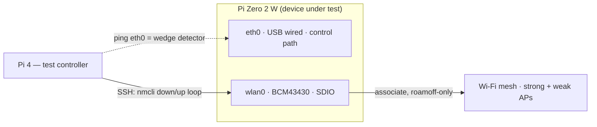

# 完整排錯 writeup —— Pi Zero 2 W 在 mesh 上的 Wi-Fi `status_code=16`

[← 回 README](../README.zh-TW.md) · 語言:[English](troubleshooting.en.md) · **繁體中文** · [日本語](troubleshooting.ja.md) · [한국어](troubleshooting.ko.md)

> 來自三台樹莓派(Zero 2 W、3B+、Pi 4)接在小米 Wi-Fi 6 mesh(BE6500 + BE3600)的家用部署現場筆記。主機相關機密(Wi-Fi 密碼、SSID、BSSID、內網 IP)皆以佔位符取代。

## 1. 一句話結論

Zero 2 W 的 Wi-Fi 晶片是老的 **BCM43430**(韌體 `7.45.96.s1`,2023)。真正重要的是兩件事——加密,以及**關掉韌體的漫遊引擎**:

1. **加密 —— 用純 WPA2-PSK**(見下方「加密模式」表:純 WPA3/SAE 必定失敗;混合模式連得上但時好時壞)。
2. **驅動層:`options brcmfmac roamoff=1`** —— 關掉韌體漫遊引擎,而那正是 **mesh band steering**(真正的主兇)會卡住的東西。在本測試網路,**單靠它就在 ~88% 的冷開機自動連上強節點**(見 §7c)—— **不必硬鎖 BSSID**,設定也保持可攜。
3. **(選擇性 —— 只在需要時)鎖一個強節點 BSSID**(`802-11-wireless.bssid AA:BB:CC:DD:EE:FF`)—— 這會**保證**每次都連強 AP,但很脆:換路由器就會壞(見 §3 的可攜性區塊)。只在「roamoff=1 還是漂到爛 AP」或「你的 mesh 一直 reject」時才加。

### 加密模式 —— 精確事實(重要)

| AP 加密 | 這顆老晶片的結果 |
|---|---|
| 純 WPA3 / SAE | **必定失敗**(Zenfone 對照實驗確認:單一 AP 純 WPA3 失敗、純 WPA2 秒連) |
| WPA2/WPA3 **混合** | **連得上但時好時壞** —— 客戶端(wpa_supplicant)協商 PSK 而非 SAE,所以*能*關聯。訊號強冷開機 ~1–2 秒連上;訊號弱或熱重開要被擋好幾次(最多約 4 次、實測拖到約 35 秒)甚至失敗。 |
| 純 WPA2 | **可靠**(建議) |

> 註:本部署現在跑的是**roamoff-only(不鎖 BSSID)+ 混合模式加密 + 強訊號**——Wi-Fi 只是備援,鎖 BSSID 的脆弱性不值得(拆鎖的依據見 §7c)。想徹底消除混合模式的不穩就改純 WPA2。另注意:這裡**沒有任何驅動層 SAE 保護** —— `feature_disable` 在本晶片不生效(見 §3),所以混合模式能連純粹是因為*客戶端*自己偏好 PSK。

## 2. 怎麼認出這個問題

```
wpa_supplicant: wlan0: CTRL-EVENT-ASSOC-REJECT bssid=00:00:00:00:00:00 status_code=16
wpa_supplicant: wlan0: CTRL-EVENT-SSID-TEMP-DISABLED ... auth_failures=N reason=CONN_FAILED
```

- `nmcli con up` 最後說 `Secrets were required, but not provided`。這是多次關聯失敗後 NetworkManager 的**誤導**訊息 —— **密碼是對的**。
- `bssid=00:00:00:00:00:00`(全零)= 韌體在 4-way 握手**之前**就擋掉關聯 → AP 加密/模式不相容,非帳密。

確認 AP 實際廣播的是什麼:

```bash
sudo iw dev wlan0 scan | grep -iA22 'SSID: <YOUR_SSID_2G>' | grep -iE 'RSN|Authentication suites|Capabilities|MFP'
```

| Scan 顯示 | 意義 | 老晶片結果 |
|---|---|---|
| `Authentication suites: PSK SAE` | WPA2/WPA3 **混合**(含 SAE) | 連得上但時好時壞 |
| `Authentication suites: SAE` | 純 WPA3 | **必定失敗** |
| `Authentication suites: PSK` | 純 WPA2 | **可以連** |

## 3. 修法(純 WPA2 + roamoff=1;鎖 BSSID 選擇性;Wi-Fi 6 可保留)

**路由器:** 把 2.4GHz SSID 設成**純 WPA2-Personal**(關 WPA3/混合)。Wi-Fi 6 可保持開啟。mesh 仍會 band-steer,但客戶端的 `roamoff=1` 會處理掉——鎖 BSSID 是*選擇性*的(見下)。

**客戶端(預設 —— roamoff-only、不鎖):**

```bash
sudo nmcli con modify "<YOUR_SSID_2G>" \
  802-11-wireless-security.key-mgmt wpa-psk \
  802-11-wireless-security.psk '<YOUR_WIFI_PASSWORD>' \
  802-11-wireless-security.pmf disable \
  connection.autoconnect yes connection.autoconnect-retries 0
sudo nmcli con up "<YOUR_SSID_2G>" ifname wlan0
```

接著套用驅動層的 `roamoff=1`(見下方「驅動層緩解」)——那才是真正打贏 band steering 的步驟。`connection.autoconnect-retries 0` = 無限重試(開機時 steering 可能擋前一兩次,會自動重試到成功)。

**選擇性 —— 鎖強 AP**(只在 roamoff-only 一直漂到弱/錯節點時才用):

```bash
sudo nmcli con modify "<YOUR_SSID_2G>" 802-11-wireless.bssid AA:BB:CC:DD:EE:FF
```

### ⚠️ 可攜性:鎖 BSSID = 綁定你那台 AP 的硬體

BSSID 是**某一台 AP 無線電的 MAC 位址**,鎖它等於把客戶端綁死在那塊硬體上。它只是針對 **band steering** 的 workaround,天生很脆:

| 情況 | 結果 |
|---|---|
| **換路由器 / mesh** | 新 AP 是新 MAC → 鎖的 BSSID 不存在 → Pi **永遠連不上**,直到你更新 |
| 被鎖節點**斷電/搬走/壞掉** | Pi **不會漫遊**去別節點(既鎖 BSSID 又 `roamoff=1`) |
| 路由器**恢復原廠/換無線模組** | MAC 可能變 → 鎖定失效 |

復原只要一行 —— 重新掃描更新,或解除鎖定:

```bash
# 找新的強節點
sudo iw dev wlan0 scan | grep -iB5 'SSID: <YOUR_SSID_2G>' | grep -iE 'BSS|signal'
# 更新成它……
sudo nmcli con modify "<YOUR_SSID_2G>" 802-11-wireless.bssid <NEW_BSSID>
# ……或完全解除鎖定
sudo nmcli con modify "<YOUR_SSID_2G>" 802-11-wireless.bssid ""
```

**什麼時候根本不用鎖:**
- **單一 AP(非 mesh):** 沒有 band steering → 純 WPA2 + `roamoff=1` 通常就夠。可攜性最好、換路由器也不壞。
- **另一套 mesh:** 要重新鎖新 mesh 的強節點。
- **最乾淨(AP 端):** 給老客戶端開一個關掉 band steering / 綁固定節點的專用 SSID —— 客戶端就完全不必鎖,換客戶端或換韌體都不會壞。

### 驅動層緩解(建議)

```
# /etc/modprobe.d/brcmfmac.conf
options brcmfmac roamoff=1
```

`roamoff=1` 關掉韌體內建漫遊引擎 —— 直接對付 band steering。用 `sudo modprobe -r brcmfmac && sudo modprobe brcmfmac` 套用,或重開機。確認生效:`cat /sys/module/brcmfmac/parameters/roamoff` → `1`。

> **關於 `feature_disable` 的實測注意。** 很多論壇推薦
> `options brcmfmac roamoff=1 feature_disable=0x82000`(`0x82000` 用意是關 SAE + SWSUP)。**在這顆 BCM43430 上完全沒效** —— `cat /sys/module/brcmfmac/parameters/feature_disable` 讀出來是**空的**(此晶片驅動不透過 sysfs 暴露這個參數)。只有 `roamoff=1` 實測有用。換別顆晶片結果可能不同。

## 4. 硬體脈絡 —— 原廠 vs 改裝的 Zero 2 W

**原廠 Zero 2 W 只有 Wi-Fi。** 本部署加了 **USB 乙太 HAT**(Waveshare ETH/USB HUB,晶片:Realtek **RTL8152B** USB→10/100、USB hub **FE1.1S**),才有有線 `eth0`。全部共用**同一條 USB 2.0**(Pi → FE1.1S hub → RTL8152)。影響:

- 最高 100 Mbit(USB 2.0 上限)—— `eth0 speed=100` 正常。
- hub 由 Pi 供 5V。**供電瞬斷或接觸不良會讓整條匯流排掉線** —— `eth0` netdev 直接消失,所以任何 link 狀態檢查都要能容忍 `ENOENT`、不可 crash。
- 有了乙太才能跑「**有線為主、Wi-Fi 備援**」(最穩架構)。沒有的話(多數讀者),上面的 Wi-Fi 修法就是你唯一的命脈、更重要。

## 5. 韌體版本與「降到 9.88.4.65」的陷阱

實機檢查(`dmesg | grep brcmf`):

```
using brcm/brcmfmac43430-sdio for chip BCM43430/1
Firmware: BCM43430/1 wl0: Jun 14 2023 ... version 7.45.96.s1 (gf031a129)
```

- 晶片 = **BCM43430/1**(rev 1),韌體 = **`7.45.96.s1`**(載入 `cypress/cyfmac43430-sdio.bin`)。

⚠️ **網路上常見的「降到韌體 9.88.4.65」(出自上游 issue #27)對本機不適用。** 那篇講的是 **BCM43430/2 → 43436** 晶片、走 **9.88.4.x** 韌體家族。本機是 **BCM43430/1 → 7.45.x**,完全不同的韌體家族。`9.88.4.65` 在本晶片上根本不存在;硬塞別顆晶片的 `.bin` 可能讓 Wi-Fi 整個掛掉。本文引用 #27 是當「**為什麼 mesh 切換會 halt 韌體**」的根因出處,**不是**叫你照它降級。

| | 本機 | issue #27 的機器 |
|---|---|---|
| 晶片 | BCM43430**/1** | BCM43430**/2**(43436) |
| 韌體家族 | **7.45.x**(`7.45.96.s1`) | **9.88.4.x**(壞 `.77` / 好 `.65`) |
| 韌體檔 | `cyfmac43430-sdio.bin` | `brcmfmac43436-sdio.bin` |

## 6. 受控實驗

### 6a. Wi-Fi 6 不是元兇(已更正的誤判)

一開始我懷疑 Wi-Fi 6(802.11ax/HE)。**把 Wi-Fi 6 開回來、維持純 WPA2,Zero 2 W 照樣連上 —— 重連第一次就成功、重開機也自動連回。** 所以**別**為一台老客戶端把 2.4GHz 降到 Wi-Fi 4/5(那會拖慢每一台 2.4GHz 裝置)。保留 Wi-Fi 6,只要把加密維持純 WPA2 即可。

### 6b. 三台裝置對照(同 bug 家族,嚴重度不同)

| 板子 | 晶片 / 韌體 | 頻段 | 本次開機 `status_code=16` | 結果 |
|---|---|---|---|---|
| **Zero 2 W** | BCM43430 / 7.45.96(舊) | 只有 2.4GHz(躲不掉 steering) | 每次開機 2–7 次,常連不回 | 修前 flaky ~60% |
| **Pi 3B+** | BCM4345/6 / 7.45.265 | 5GHz | 4 次(自己撐過) | ✅ 連著 |
| **Pi 4** | BCM4345/6 / 7.45.265 | 5GHz | 0 次 | ✅ 連著 |

3B+ 同樣中招但撐了過去;新晶片 + 新韌體 + 能待在 5GHz(遠離 steering 戰場)讓它實務上沒事。**3B+/Pi 4 不需要 `brcmfmac.conf`** —— 沒壞別修。

### 6c. 驅動修正 —— 前 / 後對照

維持 Wi-Fi 6 + 純 WPA2 + 鎖 BSSID,再加 `roamoff=1`:

| | 改前 | 改後 |
|---|---|---|
| 開機自動連 | ~60%(4 成完全失敗) | 第一次開機 **0 reject、秒連**;之後重開亦 ≤1 reject 內連上 |
| 15× 斷線重連 | —— | 6/6 連上,reject 5→4→3→1→0 遞減 |

淨改善。仍有零星 steering reject(AP 端行為,驅動關不掉),但客戶端現在最終都連得上 —— 當備援足夠。

### 6d. ⚠️ wedge:別對這顆晶片壓測

**一天內 Zero 2 W 兩次整塊板子卡死**,都得實體斷電(連乙太 + SSH 一起死):

1. 10× 重開機迴圈 → 第 8 次凍住。
2. 背靠背斷線重連 → 第 6 個 cycle 整台 hang。

根因對應上游 **RPi-Distro/firmware-nonfree #27**(「BCM43430/2 firmware stuck when switching between mesh endpoints」):密集 mesh 重關聯會**讓 Wi-Fi 韌體 halt**,在低功耗的 Zero 2 W 上連鎖成整板 hang(再疊加 USB hub brownout)。兩次卡死後 SD 卡都沒事(`throttled=0x0`、無 ext4 錯誤)—— 但反覆硬斷電本身就有風險。

**這個脆弱性是 Zero 2 W 專屬。** 對照測試:**Pi 4 與 3B+ 各跑 1000× 斷線重連 → 1000/1000 成功、零韌體 halt、零整板 hang。** CYW43455(BCM4345/6,韌體 7.45.265)免疫;它只 retry、不 halt。

### 6e. 更正後的安全結論:慢速重連沒問題

wedge 是**背靠背**重關聯造成的,不是重連本身。**間隔 ≥10 秒**時:100 個重連 cycle → **100/100 PASS、零 ASSOC-REJECT、零 hang、全程 `throttled=0x0`**,每次 0–1 秒連上。所以當備援、用正常(非猛打)行為,Wi-Fi 是可靠的。

> 壓測時的旁觀發現:密集 Wi-Fi 活動會擾動 USB 接的 `eth0`(共用 USB 匯流排),所以判斷真正 wedge 要看「**eth0 與 wlan0 同時死 + log 凍住**」,別只看 eth0。

## 7. 後續實驗 —— 儀器化重連測試 + eth0「主機層 stall」發現

修法定案後又跑了一輪儀器化更好的測試。此時控制端已從 Pi 3B+ 換成 Pi 4(3B+ 準備退役),所以每輪都從 Pi 4 經 SSH 驅動,Zero 2 W 本機跑 `nmcli con down/up` 迴圈並自己寫 log。

**測試架構** —— Pi 4 驅動測試並盯著有線側;Zero 2 W 是受測裝置:



### 7a. 三輪儀器化 100 輪測試

每輪 = 100 個 `nmcli con down → sleep 5 → con up → 等 IP → sleep N` 循環。每輪記:PASS/FAIL(有沒有拿到 IP)、重連時間、`ASSOC-REJECT` 數、`vcgencmd get_throttled`。Pi 4 同時跑「wedge 偵測器」—— ping Zero 2 W 的**有線** `eth0` 來抓整台 hang。

| 輪 | 輪間間隔 | wedge 探針 | wlan 重連 | ASSOC-REJECT | throttled≠0 | 慢(>3s) | 整台 wedge |
|-----|------|------|------|------|------|------|------|
| RUN1 | 10s | 單 ping(`-c1 -W2`) | **100/100** | 0 | 0 | 0 | 無 |
| RUN2 | 10s | 3 連 ping(`-c3 -W1`) | **100/100** | 0 | 0 | 0 | 無 |
| RUN3 | 15s | 3 連 ping(`-c3 -W1`) | **100/100** | 0 | 0 | 0 | 無 |

三輪 wlan 重連都鐵打(鎖 BSSID 與 roamoff-only 兩種設定皆然)。*有趣*的結果在**有線**那側。

### 7b. eth0「掉線」是主機層 stall,不是 link 斷

wedge 偵測器一直記到 eth0 ping 失敗 —— RUN1(單 ping)88 次;RUN2/RUN3(3 連 ping)57/52 次。它們**平均分佈、每輪一次**,從不連續。所以每次 wlan0 重關聯時,有線 eth0 會不可達 ~2-3 秒,然後恢復。

第一直覺(以及我早先的一個註記)怪到共用 USB 匯流排:「密集 WiFi 活動擾動 USB 接的乙太網卡」。**一個對照實驗推翻了它。** 觸發一次 wlan0 重連、同時高頻取樣 eth0:

- `eth0 carrier_changes`:**2 → 2(差 0)** —— 實體 link 一次都沒 flap。
- 整段期間 `carrier` 維持 `1`、`operstate` 維持 `up`。
- Pi-4 → eth0 的 ping 失敗*精準*落在 wlan0 `dormant` 重關聯窗口 —— 而 link 全程沒掉。

**結論:這不是實體 link 斷。是 2W 在 wlan0 重關聯那 ~2-3 秒單純停止回 eth0 的 ICMP —— 主機層 stall。** 可能原因:NetworkManager 重算路由、弱 CPU 忙著跑 `wpa_supplicant`+DHCP,以及 —— 值得注意 —— **eth0 和 wlan0 在同一個子網**,所以重設一個會擾動共享路由。這也*機制上*推翻了「USB 匯流排」說:在 Zero 2 W 上 Wi-Fi 是 **SDIO**、乙太是 **USB** —— 完全不同的匯流排。同一個 stall 的下游效應:一個應用層 HTTP 連線探測(`generate_204`)從 eth0 出去時偶爾逾時,因為主機在重關聯時短暫無法服務它。

一次 wlan0 重連的時間軸(eth0 link 全程沒掉,只有 ICMP stall):

```text
One wlan0 reconnect: eth0 link never drops, only ICMP stalls (~2-3 s)

  t (s):            0      2      4      6      8     10
  wlan0:            |-- up --|dormant|----- up ----|
  eth0 carrier:     |======== 1, never drops ========|   (carrier_changes 2 -> 2)
  Pi4 -> eth0 ping:  OK     OK    FAIL  FAIL  FAIL   OK
                                  \___ eth0 unreachable ~2-3 s ___/
```

> **方法論註 —— 量對訊號。** 單一 `ping -c1 -W2` 是很弱的 wedge 偵測器:漏一個封包 ≠ link 斷 ≠ hang。3 連 ping,加上規則「*只有當 eth0 **和** wlan0 都死**且**裝置自己的 log 停止推進時才算 wedge*」,才讓「wedge vs 良性」的判定可靠。真 wedge 是一整塊持續失敗 + log 凍住;這些是孤立的單輪 blip、且 log 一路推進到 100。

### 7c. roamoff-only —— 硬鎖 BSSID 其實多餘

原始修法鎖一個特定 AP BSSID 來閃 band steering,但鎖死的 MAC 很脆(換路由器就壞)。所以我們測**完全拆掉鎖**、只靠 `roamoff=1`,讓 `wpa_supplicant` 自己挑 AP:

- 40 個重連循環、不鎖 BSSID → **40/40 連上**、**38/40(95%)自己連到強節點**、那 2 次挑到較弱節點的也照樣連上,只有 1 輪有 reject。

接著我們測了**冷開機路徑**(`nmcli con down/up` 測不到 —— 它跳過韌體/NetworkManager 的開機初始化)。**合計 41 次重開、間隔 ≥30 秒:**

- **41/41 開機回來、0 整台 wedge**、**0 ASSOC-REJECT**、0 欠壓。
- **~88% 自動連到強節點**;其餘落在*同一個*較弱的同 SSID 節點(−63 dBm,仍可用);有一次只是在取樣窗內連得較慢。

代表性摘錄(已消毒 —— 真實 BSSID/IP 已換掉):

```text
reboot  1   PASS   -> strong node    reject=0   throttled=0x0
reboot  8   PASS   -> weak node      reject=0   throttled=0x0   (-63 dBm, still usable)
reboot 30   PASS   -> strong node    reject=0   throttled=0x0
----------------------------------------------------------------
41/41 booted  ·  0 board-wedge  ·  ~88% strong node  ·  0 ASSOC-REJECT  ·  0 undervoltage
```

兩個重點:

1. **roamoff-only 在開機時可靠自動連線** —— 通常連強 AP,偶爾連較弱的。所以對備援 link,`roamoff=1` 單獨就夠;**只在需要*保證*強 AP 時才鎖 BSSID**(鎖會強制每次都強,代價是可攜性)。
2. **「背靠背才弄死、間隔夠就安全」這條規則,對*重開機*也成立,不只重連。** 之前一個密集重開迴圈曾把這塊板弄 wedge(10 次的第 8 次),但**41 次間隔 ≥30 秒的重開從沒 wedge**。所以小規模、*有間隔*的重開測試是安全的;快速重開迴圈則不是。

整體:在本網路 `roamoff=1` 單獨就可靠連上*且*大多自選強 AP —— **硬鎖 BSSID 可以拿掉**(它以 SSID 為錨、不綁硬體 MAC,所以保持可攜)。只在必須保證特定 AP 時才留鎖。*(但書:這是單一網路 —— n=1。對更兇的 mesh,鎖 BSSID 仍是萬用後盾。)*

> **延伸警語 —— 強 RSSI ≠ 有網。** 在 mesh 上,訊號強的 AP 仍可能 backhaul(回程)死掉或壅塞,結果是「連上了卻沒網」。RSSI 量的是「你 → AP」,不是「AP → 網際網路」,所以別只信訊號強度(或關聯成功)—— 要驗端到端(ping 閘道 / HTTP `generate_204` 連線檢查,本專案的監控正是這樣做)。這顆老晶片吃不下 802.11k/v(那是讓基礎設施把客戶端從壞 backhaul 節點引開的標準),而把韌體漫遊開回來又會 wedge —— 所以客戶端只該「驗可達性,別試圖漫遊」。根治在 AP 端:有線 backhaul,或關掉 band steering / 給老客戶端一個綁定好節點的專用 SSID。

### 7d. 在生產環境測試的告誡

這些測試刻意 flap Wi-Fi,會污染節點*自己*的監控:延遲/loss/探測指標飆高、心跳看門狗可能誤報 down。紀律就是標準的維護視窗 —— 對測試窗把告警靜音和/或在儀表板標 annotation —— 這樣自己造成的凹陷日後才不會被誤認成真 incident。

## 8. 來源 —— 外部證據 vs 親手實測

### ✅ 有上游 issue / 論壇背書
| 結論 | 來源 |
|---|---|
| SAE / WPA2-WPA3 混合會擋老晶片 | raspberrypi/linux #4976(mixed-mode AP) |
| band steering / mesh 漫遊會 halt 韌體 | RPi-Distro/firmware-nonfree #27、Launchpad #1929746 |
| `roamoff=1` / `feature_disable` 是公認方向 | RPi 論壇 t=384103、blog.wijman.net |
| `status_code=16` 是長年 brcmfmac 問題,別人也中 | RPi 論壇 t=377009、fiquett.com |

### ⭐ 只有親手實測(外部沒有,或修正了外部)
1. **Wi-Fi 6 無罪** —— 開回 Wi-Fi 6 + 純 WPA2 仍連得上來證明(也推翻我自己最初的猜測)。
2. **安全重連門檻 ≥10 秒** —— 由 100/100 慢速重連測試量化(#27 只說「會 halt」,沒講多密集才危險)。
3. **`feature_disable=0x82000` 對本晶片沒效** —— sysfs 讀出來是空的;只有 `roamoff=1` 實測有用。(修正常見論壇建議。)
4. **要鎖的那個強節點 BSSID** —— 此 mesh 專屬。
5. **三台嚴重度對照 + 1000× 免疫測試** —— 外部報告都是單機;這裡把晶片隔離成唯一變數。
6. **「整板 wedge」比 #27 描述更嚴重** —— #27 說「漫遊壞」;這裡韌體 halt 連 eth0 + SSH 一起拖死,要斷電。
7. **排除電力/SD** —— wedge 時 `throttled=0x0`、事後 SD 完好。
8. **實機韌體 = 7.45.96.s1(BCM43430/1)** → 據此判定 #27 的 9.88.4.65 降級不適用。

### 參考連結
- Raspberry Pi Forums — ASSOC-REJECT bssid 00:00:00 status_code=16: https://forums.raspberrypi.com/viewtopic.php?t=377009
- raspberrypi/linux #4976 — brcmfmac fails to connect to WPA2/WPA3 mixed-mode AP: https://github.com/raspberrypi/linux/issues/4976
- RPi-Distro/firmware-nonfree #34 — ASSOC-REJECT with SWSUP (BCM4345 Rpi3+/4): https://github.com/RPi-Distro/firmware-nonfree/issues/34
- RPi-Distro/firmware-nonfree #27 — Zero 2 W: BCM43430/2 firmware stuck when switching between mesh endpoints: https://github.com/RPi-Distro/firmware-nonfree/issues/27
- Raspberry Pi Forums — brcmfmac.feature_disable=0x82000: https://forums.raspberrypi.com/viewtopic.php?t=384103
- Launchpad #1929746 — RPi Wi-Fi incompatibility with fast roaming (802.11r): https://bugs.launchpad.net/raspbian/+bug/1929746
- blog.wijman.net — Make Raspberry Pi Zero 2 W Wi-Fi work correctly: https://blog.wijman.net/make-raspberry-pi-zero-2w-wifi-work-correctly/
- fiquett.com — RPi5 Wi-Fi rejected by eero status_code=16 (2026-04): https://fiquett.com/2026/04/raspberry-pi-5-wifi-rejected-by-eero-status_code16-and-what-finally-fixed-it/

## 9. 最終狀態

- Zero 2 W 連上 `<YOUR_SSID_2G>` → 取得 DHCP、Wi-Fi 6 + 純 WPA2、鎖 BSSID、`brcmfmac.conf roamoff=1`、autoconnect 無限重試。開機自動連回(≤1 reject 內)。
- **有線 `eth0` 為主;Wi-Fi 為備援。**(原廠純 Wi-Fi 機:Wi-Fi 是唯一連線 —— 修法更重要。)
- 路由器維持 **Wi-Fi 6**(已證無害)。加密方面:**純 WPA2 最可靠**;純 WPA3/SAE 必定失敗;混合模式連得上但時好時壞。(本部署為備援保留混合模式 —— 想要鐵打的穩定就用純 WPA2。)
